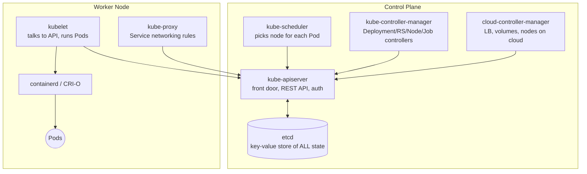
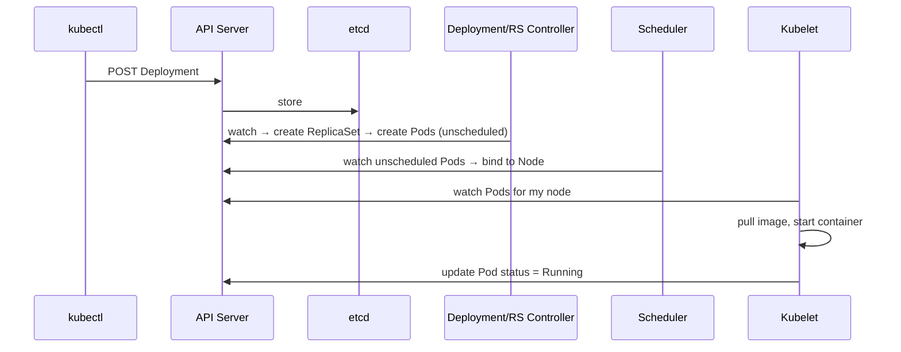
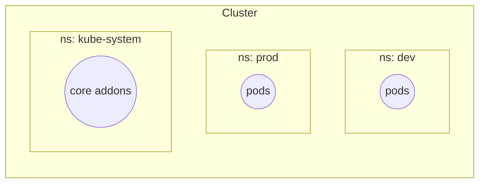

# 01 — Fundamentals

Topics: **Architecture · kubectl · Pods · Namespaces · Labels/Selectors · Annotations · API & objects**

## 1. Cluster architecture



| Component | Role |
|---|---|
| **kube-apiserver** | Only component that talks to etcd. Everything (kubectl, kubelet, controllers) goes through it. |
| **etcd** | Consistent distributed store; **back it up**. |
| **scheduler** | Filters nodes (resources, taints, affinity) then scores them; binds Pod → node. |
| **controller-manager** | Runs control loops: *observe → compare → act*. |
| **kubelet** | Node agent; ensures containers in PodSpecs are running & healthy. |
| **kube-proxy** | Programs iptables/IPVS so Service IPs reach Pods. |
| **Container runtime** | containerd/CRI-O pull images and run containers (via CRI). |

### What happens on `kubectl apply -f deploy.yaml`?


## 2. kubectl essentials
```bash
kubectl cluster-info
kubectl get nodes -o wide
kubectl get pods -A                      # all namespaces
kubectl get pod web -o yaml              # full object
kubectl describe pod web                 # events = first place to debug
kubectl logs web [-c container] [-f] [--previous]
kubectl exec -it web -- sh
kubectl apply -f file.yaml               # declarative (preferred)
kubectl create ... / run ...             # imperative
kubectl delete -f file.yaml
kubectl explain pod.spec.containers      # built-in docs!
kubectl api-resources                    # every kind + shortnames
kubectl config get-contexts              # which cluster am I on?
kubectl config use-context minikube
kubectl config set-context --current --namespace=lab
kubectl port-forward pod/web 8080:80
kubectl run tmp --rm -it --image=busybox -- sh
kubectl get pod web -o jsonpath='{.status.podIP}'
kubectl get pods --show-labels -l app=web
kubectl diff -f file.yaml                # preview changes
kubectl apply -f file.yaml --dry-run=server
kubectl run web --image=nginx --dry-run=client -o yaml > pod.yaml   # YAML generator
```
Aliases: `alias k=kubectl` · `source <(kubectl completion bash)` · `complete -F __start_kubectl k`

**Imperative vs Declarative**
| | Imperative | Declarative |
|---|---|---|
| Example | `kubectl create deploy` | `kubectl apply -f` |
| Good for | Quick tests, exams | Git, repeatability, GitOps |

## 3. Pods — the smallest deployable unit
A Pod = **1+ containers sharing network (one IP) and storage**, scheduled together on one node.

```
┌──────────────────────── Pod (IP 10.244.1.5) ───────────────────────┐
│  ┌────────────┐   ┌────────────┐                                   │
│  │ container  │   │  sidecar   │   localhost networking            │
│  │  app:8080  │◄─►│  logger    │   shared volumes                  │
│  └────────────┘   └────────────┘                                   │
│  ┌─────────────── shared volume (emptyDir) ───────────────┐        │
└────────────────────────────────────────────────────────────────────┘
```

Pod lifecycle phases: `Pending → Running → Succeeded | Failed` (+ `Unknown`).
Container states: `Waiting`, `Running`, `Terminated`.
`restartPolicy`: `Always` (default) · `OnFailure` · `Never`.

Common statuses and meaning:
| Status | Meaning | First check |
|---|---|---|
| `Pending` | not scheduled / pulling | `describe` → events |
| `ContainerCreating` | image pull / volume mount | `describe` |
| `ImagePullBackOff` | bad image/tag/credentials | image name, imagePullSecrets |
| `CrashLoopBackOff` | app keeps crashing | `logs --previous` |
| `OOMKilled` | exceeded memory limit | raise limit |
| `Completed` | finished (Jobs) | normal |

Pods are **ephemeral** (cattle, not pets) — never run bare Pods in production; use Deployments.

Manifests: [`manifests/01-pod.yaml`](manifests/01-pod.yaml) · [`02-multi-container-pod.yaml`](manifests/02-multi-container-pod.yaml)

## 4. Namespaces — virtual clusters

Default namespaces: `default`, `kube-system`, `kube-public`, `kube-node-lease`.
Namespaced vs cluster-scoped: Nodes, PVs, Namespaces, ClusterRoles, StorageClasses are **cluster-scoped**.
Cross-namespace DNS: `svc.namespace.svc.cluster.local`.
Manifest: [`manifests/03-namespaces.yaml`](manifests/03-namespaces.yaml)

## 5. Labels, Selectors, Annotations
- **Labels** = key/value used for *selection & grouping* (`app=web, env=prod, tier=frontend`).
- **Selectors** = queries: equality (`app=web`) or set-based (`env in (prod,stage)`).
- **Annotations** = non-identifying metadata (URLs, build info, tool config).

```bash
kubectl get pods -l app=web
kubectl get pods -l 'env in (prod,staging),tier!=db'
kubectl label pod web version=v2 --overwrite
kubectl annotate pod web owner=team-a
```
Services, ReplicaSets, Deployments, NetworkPolicies all **find Pods by label**.
Recommended labels: `app.kubernetes.io/name`, `/instance`, `/version`, `/component`, `/part-of`, `/managed-by`.
Manifest: [`manifests/04-labels-selectors.yaml`](manifests/04-labels-selectors.yaml)

## 6. API concepts
- Resources are grouped: core (`v1`: Pod, Service, ConfigMap…), `apps/v1`, `batch/v1`, `networking.k8s.io/v1`, `rbac.authorization.k8s.io/v1`…
- Object metadata: `name`, `namespace`, `uid`, `labels`, `annotations`, `ownerReferences`, `finalizers`, `resourceVersion`.
- **Garbage collection**: delete owner → dependents deleted (`ownerReferences`).
- **Server-side apply**, **field managers**, **watch**, **resourceVersion** (optimistic concurrency).
- Access API directly: `kubectl proxy &` then `curl localhost:8001/api/v1/namespaces/default/pods`.

## ✅ Labs
1. `make cluster` and run `kubectl get nodes`, `kubectl get pods -n kube-system`.
2. Apply `01-pod.yaml`, `describe` it, `exec` into it, `port-forward` and curl it.
3. Make the pod crash (change command to `exit 1`) and diagnose using `logs --previous`.
4. Create namespaces `dev`/`prod`, deploy the same pod name in each.
5. Label pods and query them with set-based selectors.
6. Run `kubectl explain pod.spec --recursive | less` and find 5 fields you didn't know.

## 📝 Quiz
1. Which component schedules Pods? *(scheduler)*
2. Which one stores cluster state? *(etcd)*
3. Why can two containers in a Pod use `localhost` to talk? *(shared network namespace)*
4. Difference between label and annotation? *(selectable vs non-identifying metadata)*
5. Is a Namespace a security boundary by itself? *(No — needs RBAC/NetworkPolicy/quotas.)*
