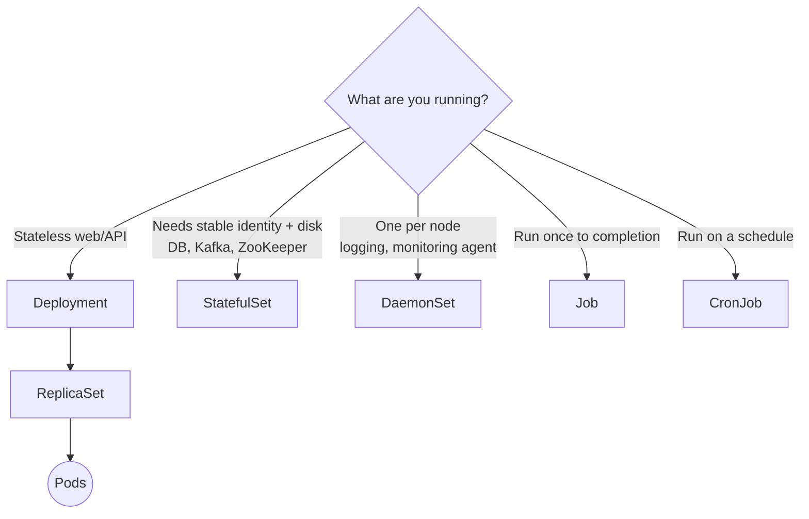
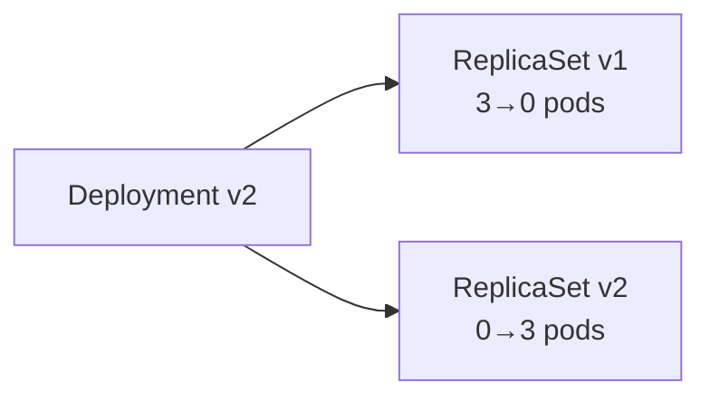

# 02 — Workloads

**ReplicaSet · Deployment · StatefulSet · DaemonSet · Job · CronJob · Rollouts · Strategies**

## Which controller do I use?


## 1. ReplicaSet
Keeps **N identical Pods** running. You rarely create it directly — Deployments manage it.
```
ReplicaSet (replicas=3, selector app=web)
   ├─ pod web-abc12
   ├─ pod web-def34
   └─ pod web-ghi56      ← delete one → RS creates a replacement
```
Manifest: [`manifests/01-replicaset.yaml`](manifests/01-replicaset.yaml)
```bash
kubectl apply -f manifests/01-replicaset.yaml
kubectl delete pod -n lab -l app=rs-demo --wait=false    # watch it self-heal
kubectl scale rs rs-demo -n lab --replicas=5
```

## 2. Deployment
Declarative updates for Pods via ReplicaSets: **rolling updates, rollbacks, scaling, pause/resume**.



### Rolling update (maxSurge=1, maxUnavailable=0, replicas=3)
```
t0  v1 v1 v1
t1  v1 v1 v1 v2          (surge +1)
t2  v1 v1 v2 v2          (one v1 removed after v2 Ready)
t3  v1 v2 v2 v2
t4  v2 v2 v2             done, zero downtime
```
Strategies: `RollingUpdate` (default) · `Recreate` (kill all, then start — causes downtime).
Advanced patterns: **Blue/Green** and **Canary** — see [`manifests/03-bluegreen-canary.yaml`](manifests/03-bluegreen-canary.yaml).

```bash
kubectl apply -f manifests/02-deployment.yaml
kubectl set image deploy/web -n lab nginx=nginx:1.27.1     # trigger update
kubectl rollout status deploy/web -n lab
kubectl rollout history deploy/web -n lab
kubectl rollout undo deploy/web -n lab                     # rollback
kubectl rollout undo deploy/web -n lab --to-revision=1
kubectl rollout pause|resume deploy/web -n lab
kubectl rollout restart deploy/web -n lab
kubectl scale deploy/web -n lab --replicas=5
```
Key fields: `replicas`, `selector.matchLabels` (immutable!), `strategy`, `revisionHistoryLimit`,
`minReadySeconds`, `progressDeadlineSeconds`.

## 3. StatefulSet
For stateful apps: **stable names (`db-0, db-1`), stable DNS, ordered start/stop, per-pod PVC**.
```
headless svc "db"  ──►  db-0.db.lab.svc   PVC data-db-0
                        db-1.db.lab.svc   PVC data-db-1
                        db-2.db.lab.svc   PVC data-db-2
start order: 0 → 1 → 2     stop order: 2 → 1 → 0
```
PVCs **survive** pod deletion and scaling down (data safe).
Manifest: [`manifests/04-statefulset.yaml`](manifests/04-statefulset.yaml)

## 4. DaemonSet
Exactly **one Pod per node** (or per matching node): log collectors (fluent-bit), node-exporter, CNI, CSI.
Manifest: [`manifests/05-daemonset.yaml`](manifests/05-daemonset.yaml)

## 5. Job & CronJob
- **Job**: run to completion; `completions`, `parallelism`, `backoffLimit`, `ttlSecondsAfterFinished`.
- **CronJob**: schedule (`*/5 * * * *`), `concurrencyPolicy` (Allow/Forbid/Replace), history limits.
```
 CronJob ──every 1m──► Job ──► Pod (runs, exits 0)
```
Manifests: [`06-job.yaml`](manifests/06-job.yaml) · [`07-cronjob.yaml`](manifests/07-cronjob.yaml)

## 6. Comparison
| | Deployment | StatefulSet | DaemonSet | Job |
|---|---|---|---|---|
| Pod names | random | ordered `name-0..n` | random | random |
| Storage | shared/none | per-pod PVC | node-local | none |
| Scaling | any | ordered | per node | n/a |
| Use | web/API | databases | agents | batch |

## ✅ Labs
1. Create the ReplicaSet, delete a pod, observe self-healing. Then change the pod template and see it **doesn't** roll (that's why we use Deployments).
2. Deploy `02-deployment.yaml`; update image; deliberately use a bad tag (`nginx:doesnotexist`) → watch rollout stall → `rollout undo`.
3. Perform Blue/Green by flipping a Service selector.
4. StatefulSet: write data in `db-0`, delete pod, confirm data persists.
5. Run the CronJob and read the logs of finished Jobs.

## 📝 Quiz
1. Why can't you edit a Deployment's `selector`? *(immutable)*
2. What creates Pods for a Deployment? *(the ReplicaSet)*
3. Which controller for node-level log agent? *(DaemonSet)*
4. What happens to PVCs when a StatefulSet is scaled down? *(retained)*
