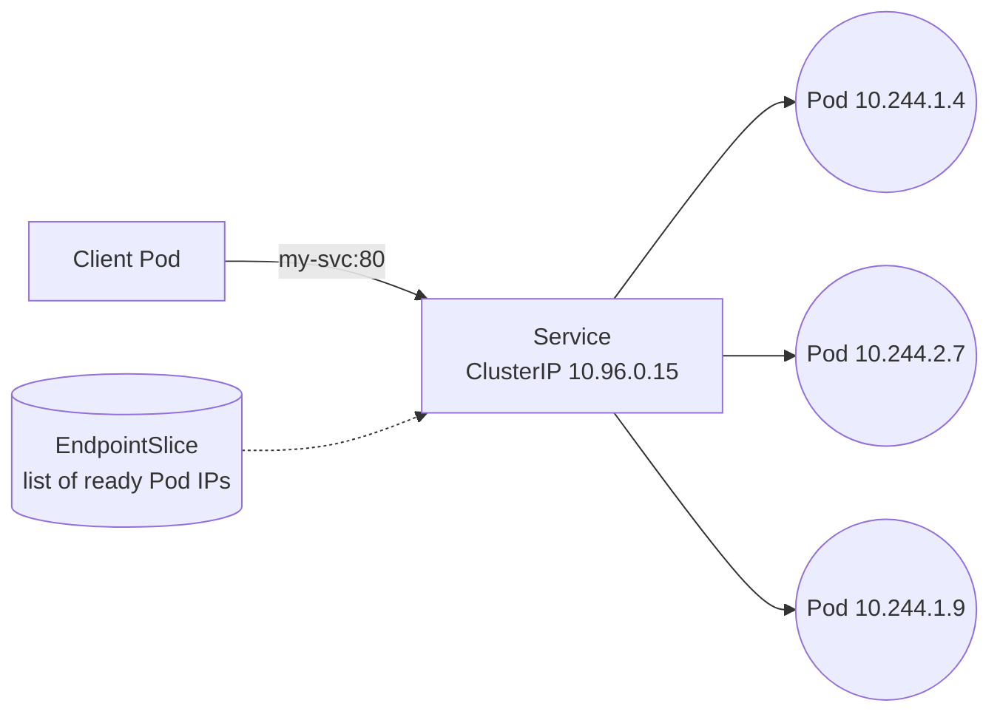
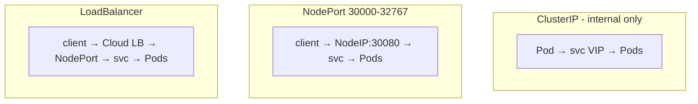
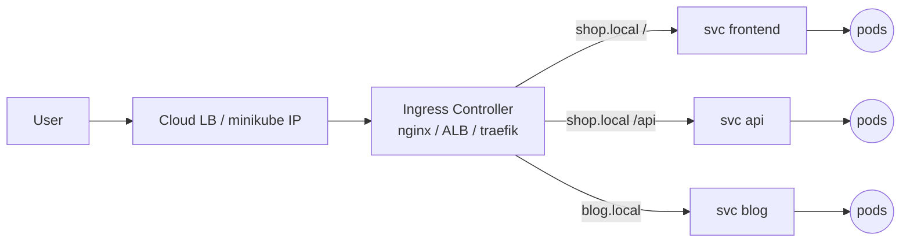
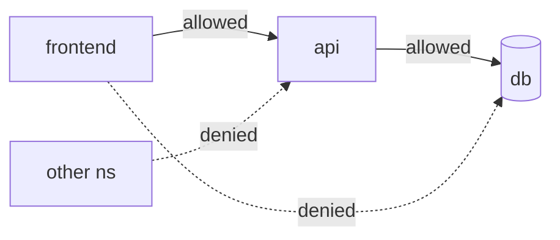

# 03 — Networking

**Cluster network model · Services (ClusterIP/NodePort/LoadBalancer/ExternalName/Headless) · DNS · Ingress · Gateway API · NetworkPolicy**

## 1. The Kubernetes network model (3 rules)
1. Every Pod gets its **own IP**.
2. Pods can reach **all other Pods** without NAT.
3. Agents on a node (kubelet) can reach all Pods on that node.
Implemented by a **CNI plugin** (Calico, Cilium, Flannel, AWS VPC CNI…).

## 2. Why Services?
Pod IPs change. A **Service** = stable virtual IP + DNS name + load balancing over Pods matched by label.


Only **Ready** Pods (passing readinessProbe) receive traffic. kube-proxy implements the VIP via iptables/IPVS.

## 3. Service types

| Type | Reachable from | Use |
|---|---|---|
| `ClusterIP` (default) | inside cluster | internal microservices |
| `NodePort` | `<nodeIP>:<30000-32767>` | dev/test |
| `LoadBalancer` | cloud LB public/private IP | production external traffic (1 LB per Service = costly) |
| `ExternalName` | CNAME to external DNS | alias external DB/API |
| Headless (`clusterIP: None`) | DNS returns Pod IPs | StatefulSets, client-side LB |

Minikube: `minikube service web -n lab --url` or `minikube tunnel` (for LoadBalancer).
Manifests: [`01-services.yaml`](manifests/01-services.yaml)

Important Service fields: `selector`, `ports[].port` (service) vs `targetPort` (container), `sessionAffinity`,
`externalTrafficPolicy` (Cluster/Local → preserve client IP), `publishNotReadyAddresses`.

## 4. DNS (CoreDNS)
```
<service>.<namespace>.svc.cluster.local
<pod-ip-dashed>.<namespace>.pod.cluster.local
db-0.db.lab.svc.cluster.local          (StatefulSet pod via headless svc)
```
From a Pod in same namespace you can use just `web`; cross-namespace: `web.lab`.
```bash
kubectl run dns --rm -it --image=busybox:1.36 -- nslookup web.lab.svc.cluster.local
kubectl get cm coredns -n kube-system -o yaml
```
Pod `dnsPolicy`: `ClusterFirst` (default), `Default`, `None`+`dnsConfig`. `ndots:5` explains slow external lookups.

## 5. Ingress — HTTP(S) routing (L7)
One entry point (one LB) → many Services by host/path, TLS termination.

**Ingress resource = rules; Ingress controller = the software that enforces them** (must be installed!).
Minikube: `minikube addons enable ingress`. Hostnames: add `$(minikube ip) shop.local` to `/etc/hosts`.
`pathType`: `Exact` · `Prefix` · `ImplementationSpecific`. TLS via a `kubernetes.io/tls` Secret (cert-manager automates it).
Manifest: [`02-ingress.yaml`](manifests/02-ingress.yaml)

## 6. Gateway API (the Ingress successor)
`GatewayClass` → `Gateway` (listeners) → `HTTPRoute` (rules). Role-oriented, supports header routing, weights, TCP/gRPC.
Manifest: [`04-gateway-api.yaml`](manifests/04-gateway-api.yaml) (requires Gateway API CRDs + a controller).

## 7. NetworkPolicy — Pod firewall
Default = **allow all**. Once a policy selects a Pod, only listed traffic is allowed (needs CNI support: Calico/Cilium; minikube `--cni=calico`).

Pattern: **default-deny** then allow-list. Don't forget **egress to DNS (UDP/TCP 53)**.
Manifest: [`03-networkpolicy.yaml`](manifests/03-networkpolicy.yaml)

## 8. Traffic flows cheat-sheet
| Flow | Path |
|---|---|
| Pod → Pod | direct via CNI |
| Pod → Service | kube-proxy DNAT → Pod |
| External → NodePort | node → kube-proxy → Pod |
| External → LB | LB → NodePort/Pod IP (AWS NLB IP mode) → Pod |
| External → Ingress | LB → ingress controller → Service/Pod |

## ✅ Labs
1. Expose `web` Deployment with ClusterIP; curl from a temp pod by name.
2. Switch to NodePort and reach it via `minikube service`.
3. Scale replicas and watch `kubectl get endpointslices`.
4. Enable ingress addon; route `/` and `/api` to two services.
5. Apply default-deny NetworkPolicy; prove `curl` fails; add an allow rule; prove it works.
6. Resolve a headless service and see multiple A records.

## 📝 Quiz
1. `port` vs `targetPort`? *(Service port vs container port)*
2. Why does an Ingress do nothing alone? *(no controller installed)*
3. Which Service type for StatefulSet peer discovery? *(Headless)*
4. Does NetworkPolicy work on every CNI? *(No — needs a policy-capable CNI)*
