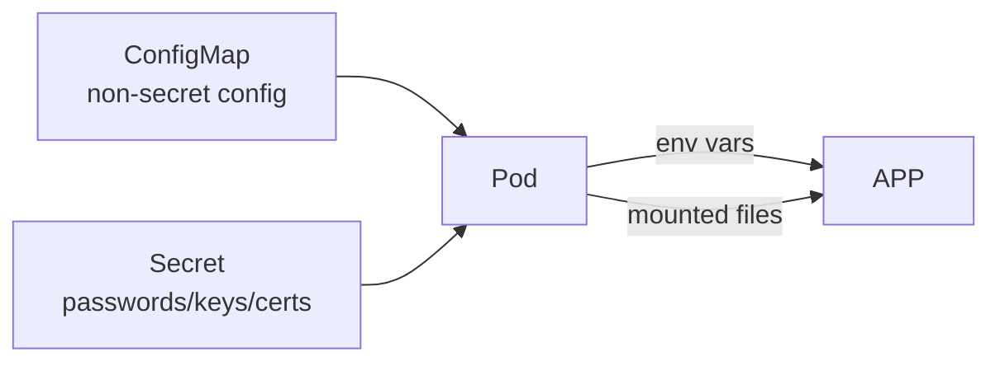

# 04 — Configuration & Storage

**ConfigMap · Secret · env/volume injection · Downward API · Volumes · PV · PVC · StorageClass · Snapshots**

## 1. Twelve-factor config: separate config from image


### ConfigMap
Ways to consume: `env[].valueFrom.configMapKeyRef`, `envFrom`, **volume mount** (files; *auto-updates* ~1 min, unlike env vars which need a restart), or `subPath` (no auto update).
Create: `kubectl create configmap app-cfg --from-literal=LOG_LEVEL=debug --from-file=app.properties`.
Manifest: [`01-configmap-secret.yaml`](manifests/01-configmap-secret.yaml)

### Secret
Types: `Opaque`, `kubernetes.io/tls`, `kubernetes.io/dockerconfigjson` (imagePullSecrets), `kubernetes.io/service-account-token`, `basic-auth`, `ssh-auth`.
⚠️ **base64 ≠ encryption!** Protect with: RBAC, **etcd encryption at rest**, external managers (AWS Secrets Manager/Vault + **External Secrets Operator** or CSI driver), **Sealed Secrets/SOPS** for Git.
```bash
kubectl create secret generic db-cred --from-literal=password='S3cr3t!'
kubectl get secret db-cred -o jsonpath='{.data.password}' | base64 -d
kubectl create secret docker-registry regcred --docker-server=<acct>.dkr.ecr.<region>.amazonaws.com --docker-username=AWS --docker-password="$(aws ecr get-login-password)"
```
`immutable: true` on ConfigMap/Secret = safer & faster.

### Downward API
Expose Pod metadata (name, namespace, IP, labels, limits) to the container — see manifest 02.

## 2. Volumes
| Type | Lifetime | Use |
|---|---|---|
| `emptyDir` | Pod | scratch, sidecar sharing (`medium: Memory` = tmpfs) |
| `hostPath` | Node | ⚠️ avoid; node agents only |
| `configMap` / `secret` / `projected` / `downwardAPI` | Pod | config files |
| `persistentVolumeClaim` | independent of Pod | durable data |
| `ephemeral` (generic ephemeral) | Pod | PVC-backed scratch |
| `csi` | driver | cloud/NFS/etc. |

## 3. Persistent storage
```mermaid
flowchart LR
  POD[Pod] -->|volumes.persistentVolumeClaim| PVC[PVC<br/>"I need 5Gi RWO"]
  PVC -->|binds| PV[PV<br/>actual disk]
  SC[StorageClass<br/>how to provision<br/>gp3 / standard] -.dynamic provisioning.-> PV
  PV --> DISK[(EBS / NFS / local disk)]
```
- **PV** — cluster resource representing real storage (admin or dynamic).
- **PVC** — a user's request for storage (size, access mode, class).
- **StorageClass** — provisioner + parameters + `reclaimPolicy` (`Delete`/`Retain`) + `volumeBindingMode` (`Immediate` / `WaitForFirstConsumer`) + `allowVolumeExpansion`.
- **Access modes**: `ReadWriteOnce` (1 node) · `ReadOnlyMany` · `ReadWriteMany` (NFS/EFS) · `ReadWriteOncePod`.
- **Lifecycle**: Provision → Bind → Use → Release → Reclaim.
- Expand PVC: edit `spec.resources.requests.storage` (if class allows).
- **VolumeSnapshots** (CSI) for backups/cloning.
- On EKS install the **EBS CSI driver** (`aws-ebs-csi-driver` addon) and use `gp3`.
Manifests: [`03-pv-pvc.yaml`](manifests/03-pv-pvc.yaml) · [`04-storageclass-eks.yaml`](manifests/04-storageclass-eks.yaml)

## ✅ Labs
1. Create ConfigMap, mount as file and as env; change it and see which updates live.
2. Create a Secret; decode it; mount read-only; try `kubectl exec ... cat`.
3. Run a Pod with a PVC, write a file, delete the Pod, recreate → file still there.
4. Use `kubectl get pv,pvc,sc` and trace the binding.
5. Expand a PVC (minikube `standard` class supports it).

## 📝 Quiz
1. Is a Secret encrypted by default? *(No, base64 only)*
2. Which survives Pod deletion: emptyDir or PVC? *(PVC)*
3. Why `WaitForFirstConsumer`? *(provision the disk in the AZ where the Pod is scheduled)*
