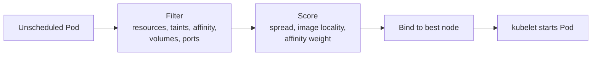

# 05 — Scheduling

**How the scheduler works · nodeName · nodeSelector · Node/Pod Affinity · Taints & Tolerations · Topology Spread · Priority & Preemption · cordon/drain**

## 1. Scheduler pipeline

If no node passes filtering → Pod stays `Pending` (`describe pod` shows *FailedScheduling* reason).

## 2. Placement tools
| Tool | Meaning | Hard/Soft |
|---|---|---|
| `nodeName` | bypass scheduler | hard |
| `nodeSelector` | node must have label | hard |
| **Node affinity** | expressive node label rules | `required…` hard / `preferred…` soft |
| **Pod affinity** | co-locate with other Pods | both |
| **Pod anti-affinity** | spread away from other Pods | both |
| **Taints/Tolerations** | node *repels* Pods unless tolerated | effect |
| **Topology spread** | even distribution across zones/nodes | `DoNotSchedule` / `ScheduleAnyway` |
| **PriorityClass** | who wins / who gets evicted | preemption |

### Taints & Tolerations
```
Node taint:  gpu=true:NoSchedule         Pod toleration: key=gpu, op=Equal, value=true, effect=NoSchedule
Effects: NoSchedule (no new pods) · PreferNoSchedule (soft) · NoExecute (evict existing)
```
**Taints keep others OUT; affinity pulls Pods IN.** Dedicated nodes = taint + label + toleration + nodeAffinity.
```bash
kubectl taint nodes node1 gpu=true:NoSchedule
kubectl taint nodes node1 gpu=true:NoSchedule-      # remove
kubectl label nodes node1 disktype=ssd
kubectl cordon node1       # mark unschedulable
kubectl drain node1 --ignore-daemonsets --delete-emptydir-data   # evict for maintenance
kubectl uncordon node1
```
Built-in taints: `node.kubernetes.io/not-ready`, `unreachable`, `memory-pressure`, `disk-pressure`.

### Topology spread
```
zone-a: pod pod       zone-b: pod pod       zone-c: pod pod     (maxSkew: 1)
```
### Priority & Preemption
High-priority Pending Pod can **evict** lower-priority Pods. `system-cluster-critical` / `system-node-critical` are built in.

Manifests: [`01-nodeselector-affinity.yaml`](manifests/01-nodeselector-affinity.yaml) · [`02-taints-tolerations.yaml`](manifests/02-taints-tolerations.yaml) · [`03-topology-priority.yaml`](manifests/03-topology-priority.yaml)

## ✅ Labs (use `minikube start --nodes 3`)
1. Label a node `disktype=ssd` and pin a Pod with `nodeSelector`.
2. Pod anti-affinity: 3 replicas must land on 3 different nodes.
3. Taint a node; show Pod Pending; add toleration; show it schedules.
4. `drain` a node and watch Pods reschedule.
5. Create 2 PriorityClasses and trigger preemption by exhausting capacity.

## 📝 Quiz
1. Taint vs affinity? *(repel vs attract)*
2. What does `NoExecute` do to running pods? *(evicts those without toleration)*
3. `requiredDuringSchedulingIgnoredDuringExecution` — what does "IgnoredDuringExecution" mean? *(label changes later don't evict a running pod)*
