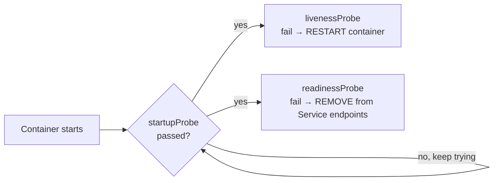
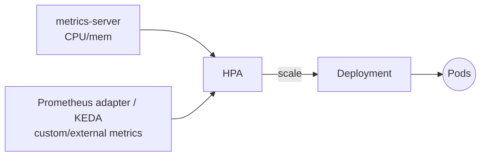
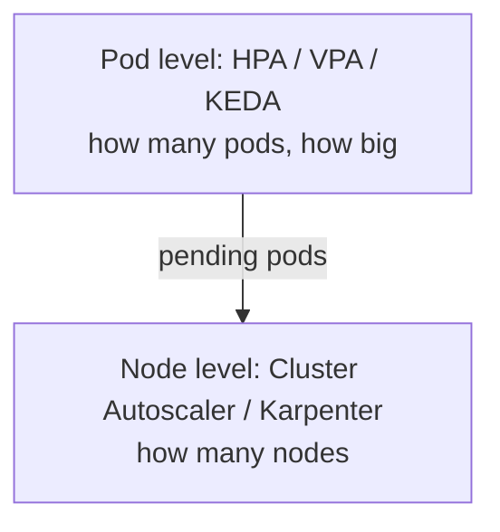

# 06 — Resources, Probes & Autoscaling

**requests/limits · QoS · LimitRange · ResourceQuota · Probes · Lifecycle hooks · HPA · VPA · Cluster autoscaling overview**

## 1. Requests vs Limits
```
requests = what the scheduler RESERVES (used for placement)
limits   = hard ceiling at runtime
CPU  (compressible):   over limit → THROTTLED
Memory (incompressible): over limit → OOMKilled
Units: 100m = 0.1 CPU · 128Mi = 128 mebibytes
```
```
Node (4 CPU)
┌──────────────────────────────────────────────┐
│ podA req 1 │ podB req 1.5 │ podC req 1 │ free 0.5 │   ← scheduling uses REQUESTS
└──────────────────────────────────────────────┘
```
### QoS classes (eviction order: BestEffort → Burstable → Guaranteed)
| Class | Rule |
|---|---|
| **Guaranteed** | every container: requests == limits (cpu & mem) |
| **Burstable** | at least one request/limit set |
| **BestEffort** | none set (first to be evicted!) |

**LimitRange** = per-namespace defaults/min/max per container. **ResourceQuota** = total namespace caps (cpu, memory, pods, PVCs, LoadBalancers…).
Manifest: [`01-resources-quota.yaml`](manifests/01-resources-quota.yaml)

## 2. Probes

| Probe | Failure action | Use |
|---|---|---|
| `startupProbe` | kill after failureThreshold | slow-starting apps; disables other probes until pass |
| `livenessProbe` | restart container | deadlock detection |
| `readinessProbe` | stop sending traffic | warming up, dependency down |
Mechanisms: `httpGet`, `tcpSocket`, `exec`, `grpc`. Tune `initialDelaySeconds, periodSeconds, timeoutSeconds, failureThreshold`.
⚠️ Never make liveness depend on external services (cascading restarts).

**Lifecycle**: `postStart`, `preStop` hooks + `terminationGracePeriodSeconds` (default 30s) → graceful shutdown: SIGTERM → preStop → wait → SIGKILL.
Manifest: [`02-probes-lifecycle.yaml`](manifests/02-probes-lifecycle.yaml)

## 3. Horizontal Pod Autoscaler (HPA)
`desiredReplicas = ceil(currentReplicas × currentMetric / targetMetric)`

- Needs **metrics-server** (`minikube addons enable metrics-server`) and Pod **CPU requests**.
- `autoscaling/v2`: multiple metrics, `behavior` (stabilization window, scale policies).
Manifest: [`03-hpa.yaml`](manifests/03-hpa.yaml). Load test:
```bash
kubectl run load --rm -it --image=busybox:1.36 -n lab -- sh -c "while true; do wget -q -O- http://php-apache; done"
kubectl get hpa -n lab -w
```

## 4. Vertical Pod Autoscaler (VPA)
Recommends/updates requests & limits (`updateMode: Off | Initial | Recreate | Auto`). Don't combine VPA(CPU) + HPA(CPU) on the same workload. Separate install (`kubernetes/autoscaler`).

## 5. The three autoscaling layers

→ Deep dives: [KEDA](../tools/05-keda) · [Karpenter](../tools/06-karpenter)

## ✅ Labs
1. Apply the quota; try to exceed it and read the error.
2. Make a Pod OOMKilled (limit 10Mi + memory hog) → `describe` shows `OOMKilled`.
3. Add a failing liveness probe; watch restarts climb.
4. Deploy php-apache + HPA; generate load; watch replicas go up then down.
5. Break readiness; show endpoints removal with `kubectl get endpoints`.

## 📝 Quiz
1. What does the scheduler use: requests or limits? *(requests)*
2. Memory over limit vs CPU over limit? *(OOMKill vs throttle)*
3. Which probe protects a slow-booting Java app from early liveness kills? *(startupProbe)*
