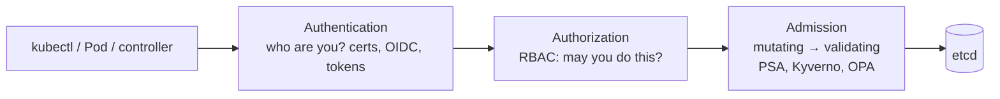
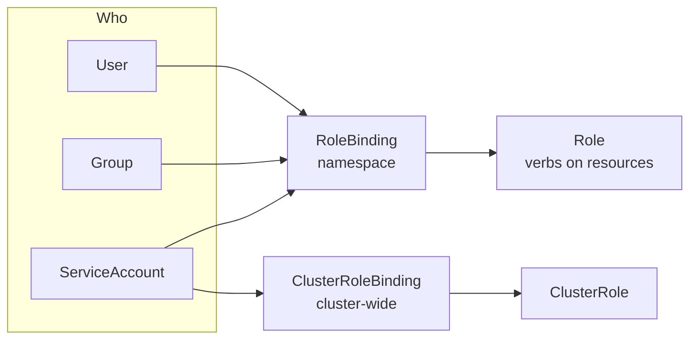

# 07 — Security

**AuthN/AuthZ/Admission · RBAC · ServiceAccounts · SecurityContext · Pod Security Admission · Secrets hardening · Supply chain · Policy engines**

## 1. Request flow through the API server


## 2. RBAC

- **Role / ClusterRole** = *what* (apiGroups, resources, verbs: get list watch create update patch delete).
- **RoleBinding / ClusterRoleBinding** = *who gets it*.
- Principle of least privilege; avoid `cluster-admin` and wildcards.
```bash
kubectl auth can-i create pods --as=system:serviceaccount:lab:dev-sa -n lab
kubectl auth can-i --list --as=jane -n lab
kubectl create role pod-reader --verb=get,list,watch --resource=pods -n lab
```
Manifest: [`01-rbac.yaml`](manifests/01-rbac.yaml)

## 3. ServiceAccounts
Identity for Pods. Each namespace has `default`. Set `automountServiceAccountToken: false` when the app doesn't call the API.
**EKS IRSA / Pod Identity**: ServiceAccount ↔ IAM role so Pods get AWS permissions without keys (used by Karpenter, EBS CSI, ALB controller, KEDA).

## 4. SecurityContext (Pod & container hardening)
```yaml
securityContext:
  runAsNonRoot: true
  runAsUser: 10001
  readOnlyRootFilesystem: true
  allowPrivilegeEscalation: false
  capabilities: {drop: ["ALL"]}
  seccompProfile: {type: RuntimeDefault}
```
Manifest: [`02-secure-pod.yaml`](manifests/02-secure-pod.yaml)

## 5. Pod Security Admission (PSA)
Namespace labels enforce profiles: **privileged**, **baseline**, **restricted** in modes `enforce | audit | warn`.
```bash
kubectl label ns prod pod-security.kubernetes.io/enforce=restricted
```
Manifest: [`03-psa-namespace.yaml`](manifests/03-psa-namespace.yaml)

## 6. Defense in depth checklist
| Layer | Controls |
|---|---|
| Image | minimal base, non-root, **Trivy scan**, sign (cosign), pin digests |
| Pod | SecurityContext, PSA restricted, no hostPath/hostNetwork/privileged |
| Network | default-deny NetworkPolicy, mTLS (service mesh) |
| Identity | RBAC least privilege, IRSA, short-lived tokens |
| Secrets | encrypt etcd, External Secrets / Vault, never in Git plain |
| Cluster | private API endpoint, audit logs, CIS benchmark (kube-bench), patch versions |
| Runtime | Falco, seccomp/AppArmor |
| Policy | Kyverno / OPA Gatekeeper (e.g. block `:latest`, require limits) |

Manifest: [`04-kyverno-policy.yaml`](manifests/04-kyverno-policy.yaml)

## ✅ Labs
1. Create SA + Role + RoleBinding; verify with `auth can-i`.
2. Exec into a Pod and call the API with its token (curl `https://kubernetes.default.svc`) — see what's allowed/denied.
3. Apply `02-secure-pod.yaml`; try writing to `/` and see it fail.
4. Label a namespace `restricted` and attempt to deploy a root Pod.
5. Scan an image with Trivy ([tools/04-trivy](../tools/04-trivy)).

## 📝 Quiz
1. Role vs ClusterRole? *(namespaced vs cluster-wide/cluster resources)*
2. What does `readOnlyRootFilesystem` prevent? *(writes to container FS – limits malware persistence)*
3. IRSA solves? *(AWS creds for Pods w/o static keys)*
