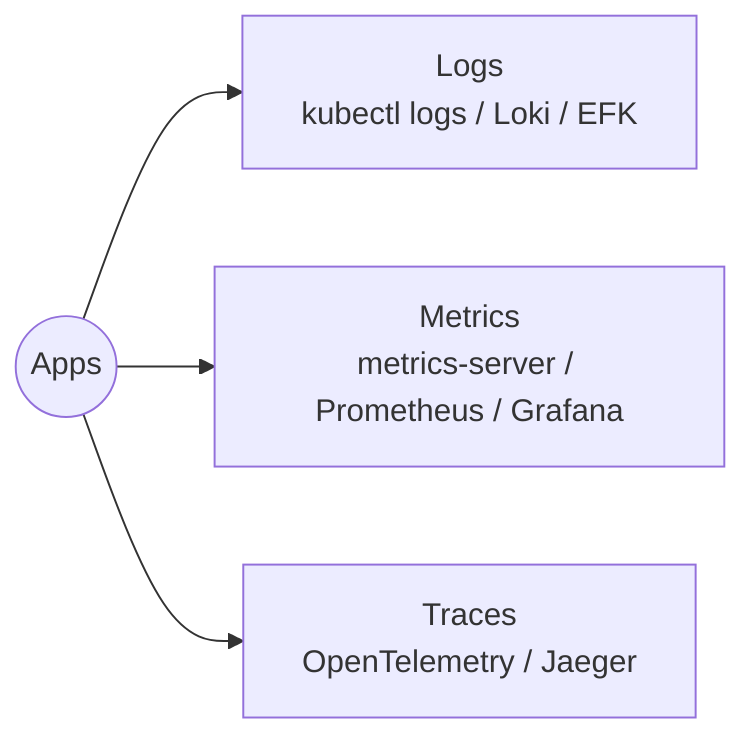
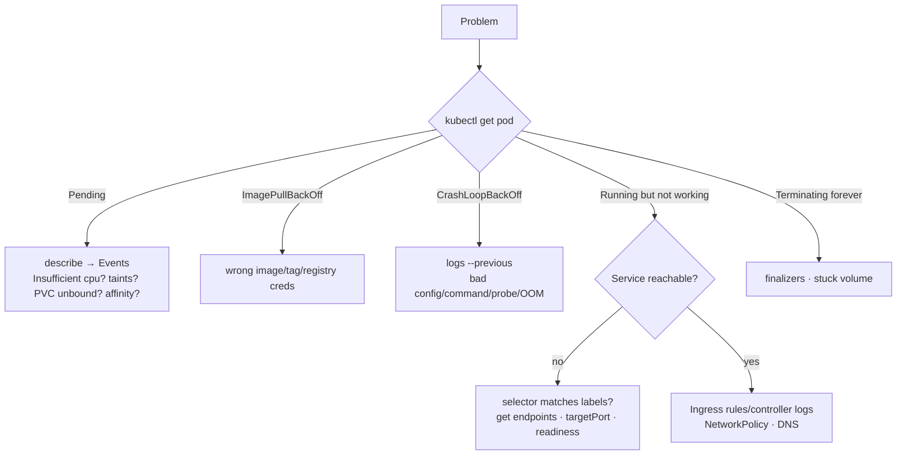

# 08 — Observability & Troubleshooting

**Logs · Events · Metrics · Prometheus/Grafana · Debugging playbook · ephemeral containers**

## 1. The three pillars

- `kubectl logs`, `kubectl top pods|nodes` (metrics-server), `kubectl get events --sort-by=.lastTimestamp`.
- Install **kube-prometheus-stack** (Prometheus + Alertmanager + Grafana) via Helm:
```bash
helm repo add prometheus-community https://prometheus-community.github.io/helm-charts
helm install monitoring prometheus-community/kube-prometheus-stack -n monitoring --create-namespace
kubectl port-forward -n monitoring svc/monitoring-grafana 3000:80    # admin / prom-operator
```
- Useful metrics: `container_cpu_usage_seconds_total`, `kube_pod_container_status_restarts_total`, `kube_deployment_status_replicas_available`.
- Logging stacks: Fluent Bit → Loki/Elasticsearch/CloudWatch.

## 2. Debugging playbook (follow in order)

### Command toolbox
```bash
kubectl describe pod <p>                         # events!
kubectl logs <p> -c <c> --previous
kubectl get events -A --sort-by=.lastTimestamp | tail -20
kubectl get endpoints <svc>                      # empty = selector/readiness problem
kubectl run dbg --rm -it --image=nicolaka/netshoot -- bash      # curl, dig, nslookup, tcpdump
kubectl debug -it <pod> --image=busybox --target=<container>     # ephemeral container
kubectl debug node/<node> -it --image=ubuntu                     # node shell
kubectl top pod --containers
kubectl get pod <p> -o jsonpath='{.status.containerStatuses[0].lastState}'
kubectl auth can-i ...
journalctl -u kubelet -f                         # on the node
```
Practice broken manifests in [`manifests/broken-apps.yaml`](manifests/broken-apps.yaml) — **find and fix each bug** (answers in [`ANSWERS.md`](ANSWERS.md)).

## ✅ Labs
1. Apply `broken-apps.yaml`; fix all 6 apps.
2. Install kube-prometheus-stack; build a Grafana panel for pod restarts.
3. Use `kubectl debug` with an ephemeral container on a distroless pod.
