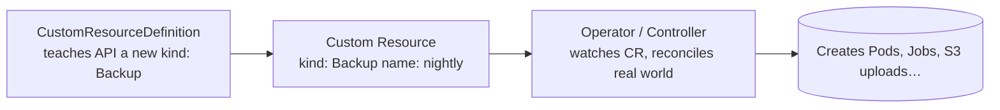

# 09 — Advanced Topics

**Init containers · Sidecars · Pod disruption budgets · CRDs · Operators · Kustomize · Helm intro · Admission webhooks · Service mesh · Multi-tenancy · Upgrades & backup**

## 1. Init containers & multi-container patterns
```
Pod start:  init-1 ──► init-2 ──► [ app + sidecar(s) ]
            (each must exit 0, in order)
```
| Pattern | Example |
|---|---|
| Init | wait for DB, fetch config, run migrations |
| Sidecar | log shipper, service-mesh proxy (native sidecars: init container with `restartPolicy: Always`, k8s 1.29+) |
| Ambassador | local proxy to remote service |
| Adapter | normalise metrics/log format |
Manifest: [`01-init-sidecar.yaml`](manifests/01-init-sidecar.yaml)

## 2. PodDisruptionBudget (PDB)
Protects availability during **voluntary** disruptions (drain, upgrades, Karpenter consolidation).
`minAvailable: 2` or `maxUnavailable: 1`. Manifest: [`02-pdb.yaml`](manifests/02-pdb.yaml)

## 3. Extending Kubernetes: CRDs & Operators

Controller pattern = **reconcile loop** (observe → diff → act → repeat). Operators encode human ops knowledge (Postgres, Kafka, Prometheus, ArgoCD, KEDA and Karpenter are all operators with CRDs!).
Tools: Kubebuilder, Operator SDK, kopf (Python). Manifest: [`03-crd.yaml`](manifests/03-crd.yaml)

## 4. Kustomize (built into kubectl)
Template-free overlays: `base/` + `overlays/dev|prod` patches.
```
kustomize/
├── base/        deployment.yaml service.yaml kustomization.yaml
└── overlays/
    ├── dev/     replicas=1, image tag dev
    └── prod/    replicas=5, resources, HPA
```
```bash
kubectl kustomize kustomize/overlays/prod      # render
kubectl apply -k kustomize/overlays/dev
```
Kustomize vs Helm: Kustomize = patching plain YAML; Helm = templating + packaging + releases. Often used together (ArgoCD supports both).

## 5. Helm intro → full guide in [tools/03-helm](../tools/03-helm)

## 6. Admission control & policy
Mutating/Validating **webhooks**, `ValidatingAdmissionPolicy` (CEL, built-in, k8s 1.30 GA), Kyverno, OPA Gatekeeper.
Manifest: [`04-validating-admission-policy.yaml`](manifests/04-validating-admission-policy.yaml)

## 7. Service Mesh (Istio / Linkerd / Cilium)
Sidecar/ambient proxies give **mTLS, retries, timeouts, traffic splitting, observability** without app changes.

## 8. Multi-tenancy
Namespaces + RBAC + Quota + NetworkPolicy + PSA (soft), vcluster/separate clusters (hard).

## 9. Cluster lifecycle
- **Upgrade order**: control plane → addons → nodes (one minor version at a time; kubelet may lag ≤ 3 minors behind API server).
- **Backup**: etcd snapshot (`etcdctl snapshot save`), **Velero** for resources + volumes.
- **Disaster recovery**: GitOps (everything in Git) + Velero + multi-AZ.
- **FinOps**: right-size requests (VPA), Spot via Karpenter, scale-to-zero via KEDA, Kubecost.

## 10. Other concepts to know
`ephemeralContainers` · `RuntimeClass` (gVisor/Kata) · `PodTemplate` · `EndpointSlices` · `Leases` · `finalizers` · `ownerReferences` · `API aggregation` · `feature gates` · `kube-proxy modes` · `CSI/CNI/CRI interfaces` · `Windows nodes` · `HugePages` · `Sidecar containers` · `In-place pod resize` · `Dynamic Resource Allocation (GPU)`.

## ✅ Labs
1. Init container that waits for a Service (`nslookup db`) before app starts.
2. Create PDB (minAvailable 2) and `drain` a node — watch eviction being throttled.
3. Apply the CRD, create a `Backup` object, `kubectl get backups`.
4. Build the Kustomize base + dev/prod overlays and diff them.
5. Take an etcd snapshot on minikube: `minikube ssh` → `sudo ETCDCTL_API=3 etcdctl ... snapshot save`.

## 📝 Quiz
1. What is an Operator? *(CRD + controller encoding operational knowledge)*
2. PDB protects against voluntary or involuntary disruption? *(voluntary)*
3. Helm vs Kustomize? *(templating/packaging vs patching overlays)*
