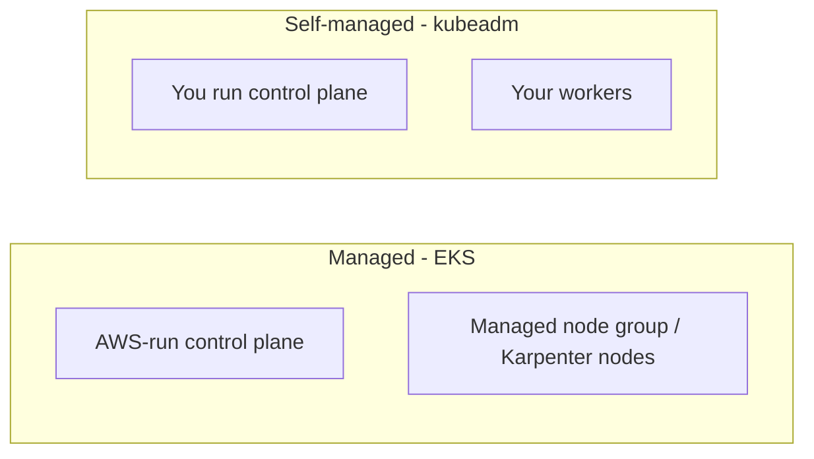

# 10 — Creating Clusters

| Option | Where | Use |
|---|---|---|
| **Minikube / kind** | laptop | learning ([tools/01-minikube](../tools/01-minikube)) |
| **kubeadm** | VMs / bare metal | learn how clusters are built; CKA |
| **EKS (eksctl)** | AWS | fastest managed cluster |
| **EKS (Terraform)** | AWS | production IaC |
| GKE / AKS | GCP / Azure | managed equivalents |

## A. kubeadm (self-managed, Ubuntu 22.04/24.04)
See [`kubeadm/README.md`](kubeadm/README.md) and scripts `install-node.sh`, `init-control-plane.sh`.

## B. EKS with eksctl (quickest)
See [`eks-eksctl/README.md`](eks-eksctl/README.md) — `cluster.yaml` included.

## C. EKS with Terraform (production way)
See [`eks-terraform/README.md`](eks-terraform/README.md) — VPC + EKS + IRSA + addons, ready to `terraform apply`.

## Post-cluster checklist
- [ ] `kubectl get nodes` Ready
- [ ] Metrics server, ingress controller / AWS Load Balancer Controller
- [ ] EBS CSI driver + `gp3` StorageClass
- [ ] Cluster Autoscaler **or** Karpenter
- [ ] Monitoring + logging
- [ ] RBAC / PSA / NetworkPolicy baseline
- [ ] etcd/Velero backups, upgrade plan
- [ ] Cost guardrails (budgets, tags). **💰 EKS costs money: delete when done!**
