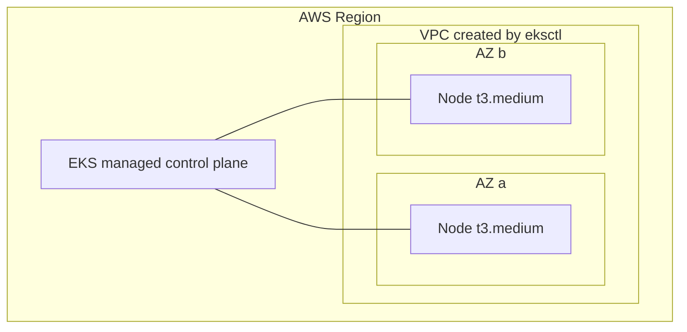

# EKS with eksctl



## Prerequisites
`aws` CLI configured (`aws configure`), `eksctl`, `kubectl`. IAM permissions for EKS/EC2/CloudFormation/IAM.

## Create
```bash
export AWS_REGION=ap-south-1           # change to your region
eksctl create cluster -f cluster.yaml  # ~15 min
aws eks update-kubeconfig --name k8s-lab --region $AWS_REGION
kubectl get nodes
```
## Install the essentials
```bash
# metrics-server
kubectl apply -f https://github.com/kubernetes-sigs/metrics-server/releases/latest/download/components.yaml
# AWS Load Balancer Controller (for Ingress=ALB, Service=NLB) -> see ../../projects/project-2-ecr-eks-deployment
```
## Delete (STOP THE BILLING)
```bash
eksctl delete cluster -f cluster.yaml --wait
```
**Cost note:** control plane ≈ $0.10/hr + nodes + NAT gateway. Always delete labs.
