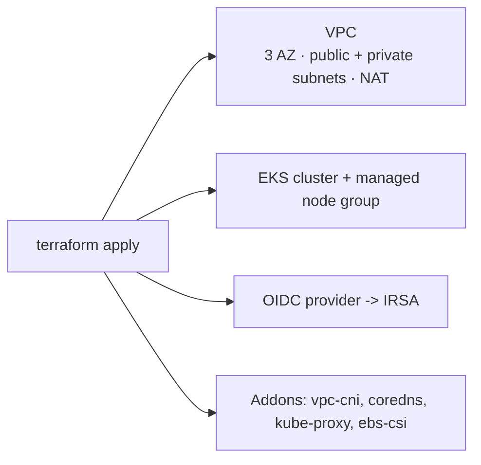

# EKS with Terraform (VPC + EKS + IRSA)

Uses the community modules `terraform-aws-modules/vpc` and `terraform-aws-modules/eks`.

## Use
```bash
cp terraform.tfvars.example terraform.tfvars   # edit
terraform init
terraform plan
terraform apply
$(terraform output -raw configure_kubectl)
kubectl get nodes
```
## Destroy
```bash
# delete any Services of type LoadBalancer / Ingresses first, else the VPC won't delete
terraform destroy
```
The subnets/security groups are tagged with `karpenter.sh/discovery` so the same cluster can be used for [tools/06-karpenter](../../tools/06-karpenter).
