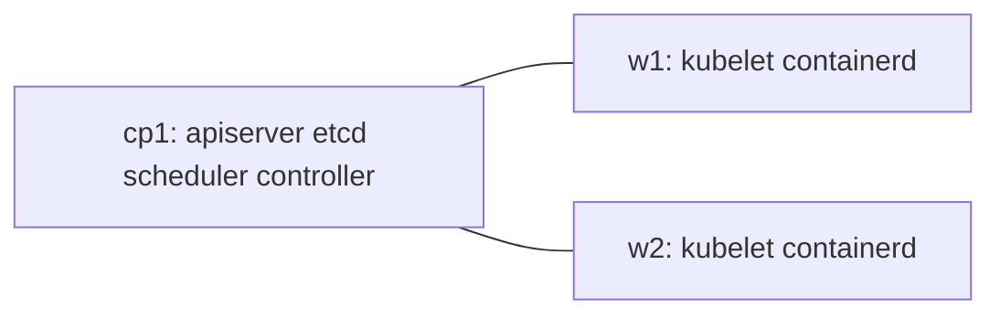

# Build a cluster with kubeadm

Topology (3 VMs, 2 vCPU/2GB+ each): `cp1` (control plane), `w1`, `w2`.

## Steps
1. **All nodes**: `sudo ./install-node.sh` (disables swap, kernel modules/sysctl, installs containerd + kubeadm/kubelet/kubectl).
2. **Control plane**: `sudo ./init-control-plane.sh` → prints a `kubeadm join ...` command.
3. **Workers**: run the join command with `sudo`.
4. Verify: `kubectl get nodes` (they become Ready after CNI is installed — done by step 2 script).
5. Practice: upgrade (`kubeadm upgrade plan/apply`), etcd backup/restore, add/remove nodes.
Reset: `sudo kubeadm reset -f`.
