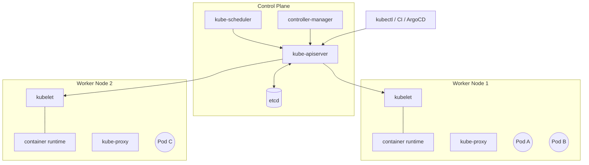

# ☸️ Kubernetes Mastery — From Zero to Advanced

> A hands-on, practice-first repository to learn **everything in Kubernetes**: core concepts,
> cluster creation, and the ecosystem tools **Minikube, ArgoCD, Helm, Trivy, KEDA, Karpenter** —
> with diagrams, runnable YAML, labs, quizzes and 6 real projects.


---

## 🎯 How to use this repo

1. Follow the modules **in numeric order** (`00` → `10`), then the `tools/`, then `projects/`.
2. Every module has: **README (theory + diagrams)** → **manifests/ (runnable YAML)** → **Labs** → **Quiz**.
3. **Don't just read — run it.** Every YAML can be applied on Minikube/kind: `kubectl apply -f <file>`.
4. Validate everything: `make validate` (kubeconform + yamllint).

```bash
git clone https://github.com/<your-username>/k8s-mastery.git
cd k8s-mastery
./scripts/check-prereqs.sh      # verify docker/kubectl/minikube/helm
make cluster                    # start local minikube cluster
cd 01-fundamentals && cat README.md
```

---

## 🗺️ Learning Roadmap

```mermaid
flowchart LR
  A[00 Prereqs<br/>Docker · Linux · YAML] --> B[01 Fundamentals<br/>Architecture · Pods · Namespaces]
  B --> C[02 Workloads<br/>RS · Deploy · STS · DS · Jobs]
  C --> D[03 Networking<br/>Services · Ingress · DNS · NetPol]
  D --> E[04 Config & Storage<br/>CM · Secret · PV · PVC]
  E --> F[05 Scheduling<br/>Affinity · Taints · Priority]
  F --> G[06 Resources & Autoscaling<br/>Limits · Probes · HPA · VPA]
  G --> H[07 Security<br/>RBAC · SA · PSA · SecCtx]
  H --> I[08 Observability<br/>Logs · Metrics · Debug]
  I --> J[09 Advanced<br/>CRD · Operators · Kustomize · PDB]
  J --> K[10 Cluster Setup<br/>kubeadm · EKS]
  K --> L[tools/<br/>Minikube · ArgoCD · Helm<br/>Trivy · KEDA · Karpenter]
  L --> M[projects/<br/>6 real-world projects]
```



| Stage | Folder | Topics | Est. time |
|---|---|---|---|
| 🟢 Beginner | `00-prerequisites`, `01-fundamentals` | Containers, architecture, kubectl, Pods, Namespaces, Labels | 1 week |
| 🟢 Beginner | `02-workloads` | ReplicaSet, Deployment, StatefulSet, DaemonSet, Job, CronJob | 1 week |
| 🟡 Intermediate | `03-networking`, `04-config-and-storage` | Services, Ingress, DNS, NetworkPolicy, ConfigMap, Secret, PV/PVC | 1–2 weeks |
| 🟡 Intermediate | `05-scheduling`, `06-resources-and-autoscaling` | Affinity, Taints, Probes, Requests/Limits, HPA/VPA | 1 week |
| 🔴 Advanced | `07-security`, `08-observability…`, `09-advanced` | RBAC, PSA, debugging, CRDs, Operators, Kustomize, PDB | 2 weeks |
| 🔴 Advanced | `10-cluster-setup` | kubeadm, EKS (eksctl + Terraform) | 1 week |
| 🛠️ Ecosystem | `tools/` | Minikube, ArgoCD, Helm, Trivy, KEDA, Karpenter | 2 weeks |
| 🚀 Projects | `projects/` | 6 end-to-end projects | 2–3 weeks |

---

## 📚 Repository Map

```
k8s-mastery/
├── 00-prerequisites/                  Docker, Linux, YAML, tool install
├── 01-fundamentals/                   Architecture, kubectl, Pods, Namespaces, Labels
├── 02-workloads/                      ReplicaSet, Deployment, StatefulSet, DaemonSet, Job, CronJob
├── 03-networking/                     Services, Ingress, DNS, NetworkPolicy, Gateway API
├── 04-config-and-storage/             ConfigMap, Secret, Volumes, PV, PVC, StorageClass
├── 05-scheduling/                     nodeSelector, Affinity, Taints, Priority, Topology spread
├── 06-resources-and-autoscaling/      Requests/Limits, QoS, Quota, Probes, HPA, VPA
├── 07-security/                       RBAC, ServiceAccount, SecurityContext, PSA
├── 08-observability-and-troubleshooting/  Logs, metrics, events, debug flow
├── 09-advanced/                       CRD, Operators, Init/Sidecar, PDB, Kustomize, Helm intro
├── 10-cluster-setup/                  kubeadm, EKS (eksctl), EKS (Terraform)
├── tools/
│   ├── 01-minikube/   02-argocd/   03-helm/   04-trivy/   05-keda/   06-karpenter/
├── projects/
│   ├── project-1-kubelab-basics/
│   ├── project-2-ecr-eks-deployment/
│   ├── project-3-argocd-gitops/
│   ├── project-4-helm-chart/
│   ├── project-5-autoscaling-keda-karpenter/
│   └── project-6-devsecops-pipeline-full-stack/
├── docs/                              Cheatsheet, glossary, troubleshooting, interview Q&A, CKA/CKAD map
├── scripts/                           check-prereqs, lab helpers, cleanup
├── Makefile
└── .github/workflows/validate.yml     CI: lint + schema-validate all YAML
```

---

## 🧠 The Big Picture (read this first)



**One-sentence model:** you declare the *desired state* in YAML → the API server stores it in etcd →
controllers constantly compare *desired vs actual* and fix the difference → the scheduler places Pods on
nodes → kubelet runs them.

---

## 🧰 Tools covered

| Tool | Purpose | Folder |
|---|---|---|
| **Minikube** | Local single-node cluster for practice | `tools/01-minikube` |
| **ArgoCD** | GitOps continuous delivery | `tools/02-argocd` |
| **Helm** | Package manager / templating | `tools/03-helm` |
| **Trivy** | Image, IaC & cluster vulnerability scanning | `tools/04-trivy` |
| **KEDA** | Event-driven pod autoscaling (incl. scale-to-zero) | `tools/05-keda` |
| **Karpenter** | Just-in-time node autoscaling on AWS | `tools/06-karpenter` |

## 🚀 Projects

| # | Project | Skills |
|---|---|---|
| 1 | [KubeLab Basics](projects/project-1-kubelab-basics) | 3-tier app (web+api+db) on Minikube |
| 2 | [ECR + EKS Deployment](projects/project-2-ecr-eks-deployment) | Build → push to ECR → deploy to EKS with LoadBalancer/Ingress |
| 3 | [ArgoCD GitOps](projects/project-3-argocd-gitops) | App-of-apps, auto-sync, self-heal |
| 4 | [Helm Chart](projects/project-4-helm-chart) | Write, test, package and publish your own chart |
| 5 | [KEDA + Karpenter](projects/project-5-autoscaling-keda-karpenter) | Pod + node autoscaling end to end |
| 6 | [DevSecOps Full Stack](projects/project-6-devsecops-pipeline-full-stack) | GitHub Actions + Trivy + ECR + ArgoCD + Helm + KEDA + Karpenter |

## 📖 Extra docs
- [Cheatsheet](docs/cheatsheet.md) · [Glossary](docs/glossary.md) · [Troubleshooting](docs/troubleshooting.md)
- [Interview Q&A](docs/interview-questions.md) · [CKA/CKAD/CKS map](docs/certification-map.md) · [Learning checklist](docs/learning-checklist.md)

## 🤝 Contributing
PRs welcome. Run `make validate` before opening one. See [CONTRIBUTING.md](CONTRIBUTING.md).

## 📄 License
MIT — see [LICENSE](LICENSE).
