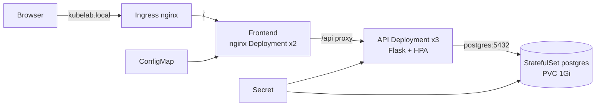

# Project 1 — KubeLab Basics (3-tier app on Minikube)

**Goal:** deploy a real web → API → database app using almost every core concept.


| Concept used | File |
|---|---|
| Namespace, quota | `k8s/00-namespace.yaml` |
| ConfigMap / Secret | `k8s/01-config.yaml` |
| StatefulSet + PVC + headless Service | `k8s/02-postgres.yaml` |
| Deployment, probes, resources, init container | `k8s/03-api.yaml` |
| Deployment + ConfigMap-mounted nginx.conf | `k8s/04-frontend.yaml` |
| Ingress | `k8s/05-ingress.yaml` |
| HPA | `k8s/06-hpa.yaml` |
| NetworkPolicy (optional, task 5) | `k8s-optional/07-networkpolicy.yaml` |
| PDB | `k8s/08-pdb.yaml` |

## Run it
```bash
make -C ../.. cluster                           # minikube + ingress + metrics-server (use --cni=calico to enforce NetworkPolicy)
eval $(minikube docker-env)
docker build -t kubelab-api:1.0 app/
kubectl apply -f k8s/00-namespace.yaml
kubectl apply -f k8s/
kubectl get all -n kubelab
echo "$(minikube ip) kubelab.local" | sudo tee -a /etc/hosts
curl http://kubelab.local/api/visit          # {"visits": 1, "pod": "kubelab-api-xxxx"}
```
(Docker driver on macOS/Windows: run `minikube tunnel` and use `127.0.0.1 kubelab.local`.)

## Tasks (do them!)
1. ✅ Hit `/api/visit` repeatedly → pod name changes (load balancing), counter increases (DB works).
2. 💀 `kubectl delete pod postgres-0 -n kubelab` → data survives (PVC).
3. 📈 Load test: `kubectl run -n kubelab load --rm -it --image=busybox -- sh -c 'while true; do wget -qO- http://kubelab-api/api/visit >/dev/null; done'` → watch HPA.
4. 🔁 Change the API (`APP_VERSION`), rebuild `kubelab-api:1.1`, `kubectl set image`, watch rolling update, then `rollout undo`.
5. 🔒 Start minikube with `--cni=calico`, then `kubectl apply -f k8s-optional/07-networkpolicy.yaml`. Prove a temp pod **cannot** reach postgres or the API directly, while the frontend still works. (Applied last so it doesn't block the load test in task 3.)
6. 🧹 `kubectl delete ns kubelab`.

## Stretch goals
Add a CronJob that cleans old rows · Add resource-based PriorityClass · Package everything as a Helm chart (→ Project 4).
