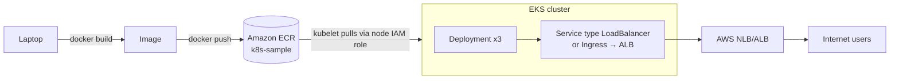

# Project 2 — Build → Push to ECR → Deploy on EKS

**Goal:** take an app from your laptop to a public URL on AWS EKS using Amazon ECR (private registry) and an AWS Load Balancer.


## Prerequisites
AWS account · `aws` CLI configured · `eksctl` · `kubectl` · `helm` · Docker.
**Cost warning:** EKS ≈ $0.10/h + EC2 + NAT/LB. Delete everything at the end (step 8).

## Steps
### 1. Create the cluster (≈15 min)
```bash
cd ../../10-cluster-setup/eks-eksctl && eksctl create cluster -f cluster.yaml
aws eks update-kubeconfig --name k8s-lab --region ap-south-1
kubectl get nodes
```
### 2. Create ECR repo, build and push
```bash
export AWS_REGION=ap-south-1
./scripts/01-build-push.sh          # creates repo (if missing), logs in, builds, tags, pushes, prints image URI
```
### 3. Deploy
```bash
export IMAGE=$(cat .image-uri)      # written by script 01
envsubst < k8s/deployment.yaml | kubectl apply -f -
kubectl apply -f k8s/service-nlb.yaml
kubectl get svc sample-app -w       # wait for EXTERNAL-IP (hostname)
curl http://<EXTERNAL-HOSTNAME>/
```
Nodes pull from ECR automatically because the managed node role has `AmazonEC2ContainerRegistryReadOnly`. (Outside EKS use an `imagePullSecret`; see `04-config-and-storage`.)

### 4. Ingress with AWS Load Balancer Controller (ALB) — optional but important
```bash
./scripts/02-install-alb-controller.sh
kubectl apply -f k8s/ingress-alb.yaml
kubectl get ingress sample-app      # ADDRESS = ALB DNS name
```
### 5. Roll out a new version
Edit `app.py` message → `VERSION=1.1 ./scripts/01-build-push.sh` → `kubectl set image deploy/sample-app app=$(cat .image-uri)` → `kubectl rollout status`.
### 6. Autoscale
Install metrics-server, then `kubectl apply -f k8s/hpa.yaml`.
### 7. ECR hygiene
Image scanning on push is enabled by the script (`scanOnPush`); view findings: `aws ecr describe-image-scan-findings`. Add a lifecycle policy: `aws ecr put-lifecycle-policy --repository-name k8s-sample --lifecycle-policy-text file://k8s/ecr-lifecycle.json`.
### 8. Clean up (IMPORTANT)
```bash
kubectl delete -f k8s/ingress-alb.yaml -f k8s/service-nlb.yaml     # remove LBs first
eksctl delete cluster -f ../../10-cluster-setup/eks-eksctl/cluster.yaml --wait
aws ecr delete-repository --repository-name k8s-sample --force
```
## Troubleshooting
| Symptom | Cause / fix |
|---|---|
| `ImagePullBackOff` `no basic auth credentials` | wrong region/account in image URI; node role lacks ECR read |
| `exec format error` | built on Apple Silicon → `docker buildx build --platform linux/amd64` (script does this) |
| EXTERNAL-IP `<pending>` forever | subnets missing `kubernetes.io/role/elb` tag; LB controller not installed (for ALB) |
| Ingress no ADDRESS | check `kubectl logs -n kube-system deploy/aws-load-balancer-controller` |
