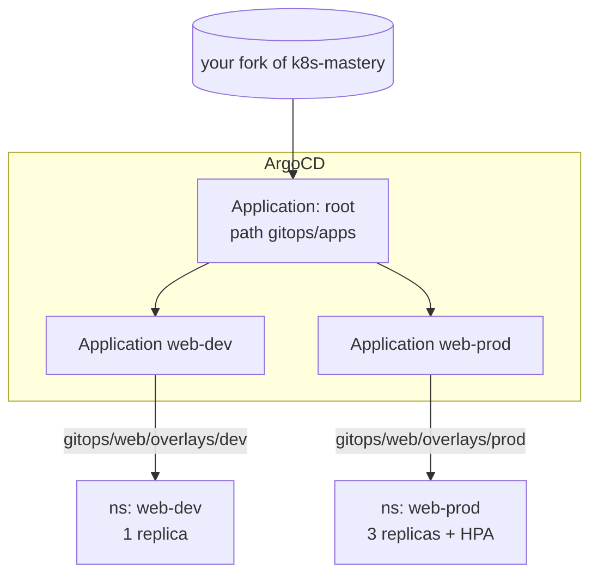

# Project 3 — GitOps with ArgoCD (App-of-Apps, dev & prod)

**Goal:** Git is the only way to change the cluster. Push to Git → ArgoCD deploys. Manual drift → reverted.


## Steps
1. **Fork** this repo and replace `<your-username>` in `gitops/apps/*.yaml`, then commit & push.
2. Install ArgoCD ([tools/02-argocd](../../tools/02-argocd)) and log in to the UI.
3. Bootstrap:
   ```bash
   kubectl apply -f gitops/bootstrap-root.yaml
   argocd app list      # root, web-dev, web-prod appear
   ```
4. Open the UI → watch resources appear. `kubectl get all -n web-dev -n web-prod`.
5. **Drift test**: `kubectl scale deploy/dev-web -n web-dev --replicas=5` → ArgoCD reverts it in seconds (selfHeal).
6. **GitOps change**: edit `gitops/web/overlays/prod/hpa.yaml` (`minReplicas: 5`), push → prod updates. (The HPA owns the replica count in prod.)
7. **Promotion**: bump the image tag in dev, test, then in prod via PR.
8. **Rollback**: `git revert <sha> && git push` (preferred) or `argocd app rollback web-prod`.
9. **Break it**: push invalid YAML → app goes `OutOfSync/Degraded`; fix in Git.
10. Add sync waves & a PreSync Job hook (see `gitops/web/base/presync-job.yaml`).

## Stretch
ApplicationSet generating per-env apps · ArgoCD Notifications to Slack · Argo Rollouts canary · private repo credentials · SSO.
