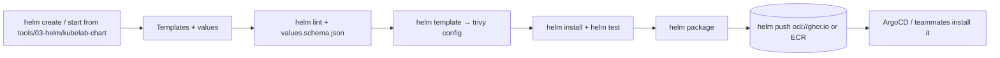

# Project 4 — Build, Test, Package & Publish a Helm Chart

**Goal:** turn the 3-tier KubeLab app into a reusable Helm chart with environments, tests, schema validation and an OCI-published package.


## Tasks (each builds on the last)
| # | Task | Hint |
|---|---|---|
| 1 | Copy `tools/03-helm/kubelab-chart` to `./mychart`, rename to `kubelab-app` | `Chart.yaml`, helpers `kubelab.*` |
| 2 | Add a **second Deployment** for the API and a **Postgres StatefulSet** toggled by `postgres.enabled` | `{{- if .Values.postgres.enabled }}` |
| 3 | Add a **Secret** from `values` (`existingSecret` option too) | `required` function |
| 4 | Add **subchart dependency**: replace your Postgres with `bitnami/postgresql` | `Chart.yaml dependencies` + `helm dependency update` |
| 5 | Add `values.schema.json` rules (replicaCount ≥ 1, service.type enum) | see sample |
| 6 | Add a **pre-upgrade hook Job** (DB migration placeholder) | `helm.sh/hook: pre-upgrade` |
| 7 | Add environment value files `environments/{dev,staging,prod}.yaml` (provided) | `-f` precedence |
| 8 | Run `helm lint`, `helm template … \| trivy config -`, fix findings | `trivy config` |
| 9 | `helm install`, `helm test`, `helm upgrade`, break something with a bad value, `helm rollback` | `--atomic` |
| 10 | `helm package` → push to OCI registry → install from it | below |

## Commands
```bash
helm lint ./mychart
helm template rel ./mychart -f environments/prod.yaml > /tmp/out.yaml && trivy config /tmp/out.yaml
helm install kubelab ./mychart -n kubelab --create-namespace -f environments/dev.yaml
helm test kubelab -n kubelab
helm upgrade kubelab ./mychart -n kubelab -f environments/prod.yaml --atomic --timeout 3m
helm history kubelab -n kubelab && helm rollback kubelab 1 -n kubelab

# publish to GitHub Container Registry
helm package ./mychart
echo $GH_TOKEN | helm registry login ghcr.io -u <user> --password-stdin
helm push kubelab-app-0.1.0.tgz oci://ghcr.io/<user>/charts
helm install demo oci://ghcr.io/<user>/charts/kubelab-app --version 0.1.0
```
## Definition of done
- [ ] `helm lint` clean · [ ] schema rejects bad values · [ ] `helm test` passes · [ ] zero HIGH Trivy misconfigs · [ ] chart published & installable from OCI · [ ] README with values table (try `helm-docs`)
