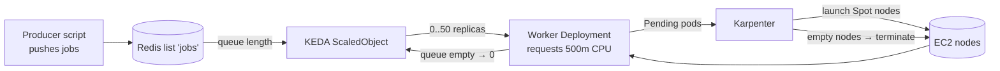

# Project 5 — Autoscaling Everything: KEDA (pods) + Karpenter (nodes)

**Goal:** a queue-driven worker that scales **from 0 pods to hundreds**, while Karpenter adds exactly the nodes needed and removes them afterwards.


## Timeline you should observe
```
t=0     queue=0      pods=0     nodes=2 (baseline)
t=+10s  queue=500    pods=0→5   Pending pods appear (no room)
t=+60s  queue=450    pods=50    Karpenter launches node(s) (NodeClaims)
t=+3m   queue=0      pods=50→0  KEDA cooldown (60s) → scale to zero
t=+6m   nodes=2      Karpenter consolidates empty nodes away
```
## Prerequisites
EKS cluster ([10-cluster-setup](../../10-cluster-setup)) + KEDA ([tools/05-keda](../../tools/05-keda)) + Karpenter with default NodePool ([tools/06-karpenter](../../tools/06-karpenter)).
*No AWS? Do the KEDA half on Minikube: it works the same, minus node scaling.*

## Run
```bash
kubectl apply -f k8s/00-namespace.yaml -f k8s/01-redis.yaml
kubectl apply -f k8s/02-worker.yaml -f k8s/03-scaledobject.yaml
kubectl apply -f k8s/04-karpenter-nodepool.yaml          # optional dedicated pool (EKS+Karpenter only)
./scripts/produce.sh 500                                  # enqueue 500 jobs
# in separate terminals
kubectl get pods -n autoscale-lab -w
kubectl get nodeclaims,nodes -w
kubectl get scaledobject,hpa -n autoscale-lab
```
## Experiments
1. Change `listLength` from 10 → 5 and re-run: how does max pod count change?
2. Set worker requests to 2 CPU: what instance types does Karpenter pick?
3. Add a **PDB** and **`karpenter.sh/do-not-disrupt`** to a pod: what happens during consolidation?
4. Limit the NodePool to `cpu: 8` and observe Pods staying Pending (guardrail).
5. Restrict NodePool to Spot only; kill a node (simulate interruption) and watch recovery.
6. Add a cron trigger to pre-scale at 09:00.
## Cleanup
`kubectl delete ns autoscale-lab && kubectl delete nodepool autoscale-pool --ignore-not-found`
