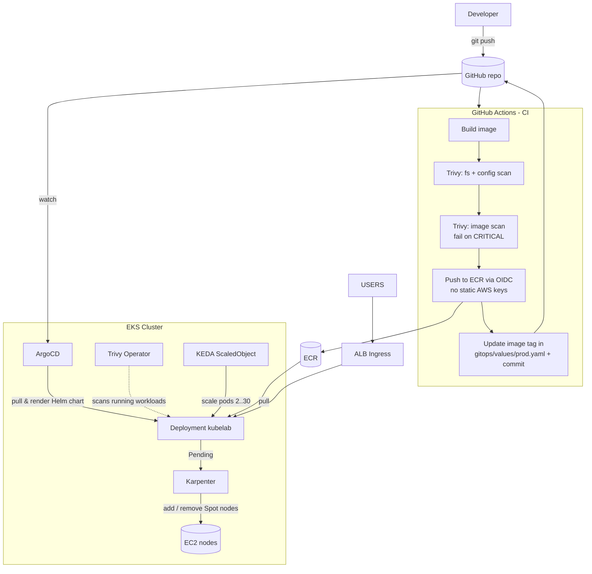

# Project 6 — Capstone: Full DevSecOps Platform on EKS

Everything in this repo, working together: **GitHub Actions → Trivy → ECR → ArgoCD → Helm → KEDA → Karpenter**.

## Components & where they come from
| Layer | Tool | File(s) |
|---|---|---|
| Cluster | EKS (Terraform) | `10-cluster-setup/eks-terraform` |
| Node autoscaling | Karpenter | `tools/06-karpenter/manifests/*` |
| Packaging | Helm chart | `tools/03-helm/kubelab-chart` |
| CI | GitHub Actions | `ci/github-actions-ci.yml` |
| Security | Trivy (CI) + Trivy Operator (runtime) | `gitops/apps/trivy-operator.yaml` |
| Delivery | ArgoCD App-of-Apps | `gitops/apps/*.yaml` |
| Pod autoscaling | KEDA | `gitops/apps/keda.yaml`, `gitops/values/scaledobject.yaml` |

## Build order
1. **Cluster**: `terraform apply` in `eks-terraform` (subnets/SGs get `karpenter.sh/discovery`).
2. **Karpenter**: install per `tools/06-karpenter`; apply `EC2NodeClass` + `NodePool`.
3. **ArgoCD**: install per `tools/02-argocd`.
4. **ECR + GitHub OIDC**: see `ci/aws-oidc-setup.md`.
5. **CI**: copy `ci/github-actions-ci.yml` to `.github/workflows/ci.yml`; set repo variables `AWS_ROLE_ARN`, `AWS_REGION`, `ECR_REPOSITORY`.
6. **Edit placeholders** `<your-username>`, `<account-id>`, `<region>` in `gitops/**`.
7. **Bootstrap GitOps**: `kubectl apply -f gitops/bootstrap.yaml` → ArgoCD installs KEDA, Trivy Operator, the app (and its ScaledObject).
8. **Push a code change** → watch the pipeline, the ArgoCD sync, and the new pods roll out.

## Acceptance tests
| Test | Expected |
|---|---|
| Add a vulnerable base image (`python:3.8`) | CI fails at Trivy gate |
| Push a normal change | image in ECR (tag = git SHA) → Git commit by CI → ArgoCD syncs → rolling update |
| `kubectl scale deploy/kubelab-web --replicas=1` | ArgoCD self-heals / KEDA keeps its target |
| Load test (`hey`/`wrk` on ALB) or cron window | KEDA scales pods up; Pending pods → Karpenter adds nodes |
| Stop load | pods scale down; nodes consolidate away |
| `kubectl get vulnerabilityreports -n kubelab` | runtime reports present |
| `git revert` last commit | ArgoCD rolls back |

## Hardening ideas (extra credit)
Sign images with **cosign** and verify with Kyverno · generate SBOM and attach · External Secrets Operator · NetworkPolicies · PSA `restricted` namespace · Argo Rollouts canary · Prometheus + Grafana dashboards · budgets/alerts · Velero backups.
