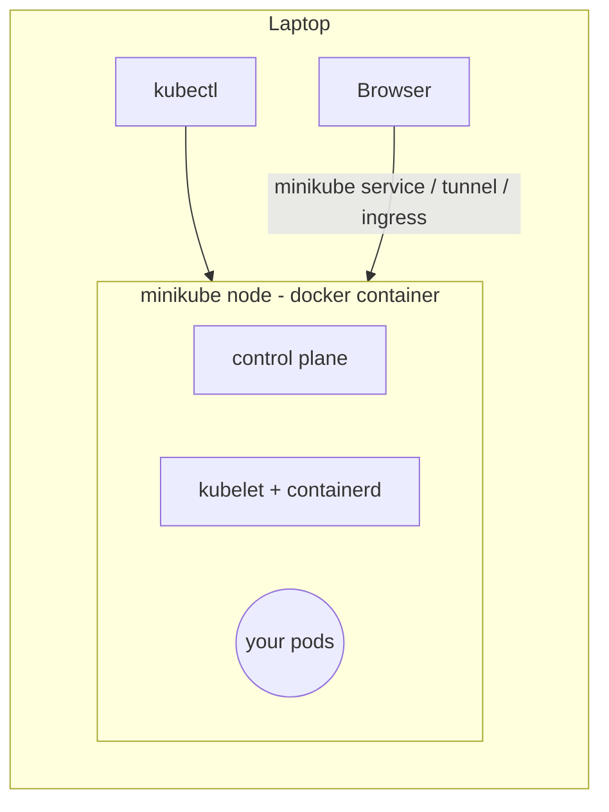

# Minikube — your local Kubernetes lab

Minikube runs a real Kubernetes cluster (control plane + node) inside a Docker container/VM on your laptop.

## Install & start
```bash
minikube start --driver=docker --cpus=4 --memory=6g          # single node
minikube start -p multi --nodes 3 --cni=calico                # 3 nodes + NetworkPolicy support
minikube status
minikube profile list
minikube dashboard --url                                      # web UI
```
## Addons
```bash
minikube addons list
minikube addons enable ingress          # nginx ingress controller
minikube addons enable metrics-server   # kubectl top, HPA
minikube addons enable registry         # local registry
minikube addons enable storage-provisioner
```
## Getting traffic into minikube
| Method | Command |
|---|---|
| NodePort | `minikube service <svc> -n lab --url` |
| LoadBalancer | `minikube tunnel` (separate terminal, needs sudo) |
| Ingress | `echo "$(minikube ip) shop.local" \| sudo tee -a /etc/hosts` |
| Quick | `kubectl port-forward svc/web 8080:80` |

## Use local images (no registry needed)
```bash
minikube image build -t k8s-sample:1.0 ../../00-prerequisites/sample-app
# or: eval $(minikube docker-env) && docker build -t k8s-sample:1.0 .
# or: minikube image load k8s-sample:1.0
# In YAML set imagePullPolicy: IfNotPresent (or Never)
```
## Handy
```bash
minikube ssh                 # shell into node
minikube logs
minikube stop | delete [-p profile] | delete --all
minikube mount ~/data:/data  # share host dir
```
## Troubleshooting
| Symptom | Fix |
|---|---|
| Driver errors | `minikube delete && minikube start --driver=docker` |
| ImagePull for local image | load image (above) + `imagePullPolicy: IfNotPresent` |
| `kubectl top` fails | enable metrics-server, wait 1-2 min |
| Ingress has no address | `minikube addons enable ingress`, wait for controller Pod in `ingress-nginx` ns |

## ✅ Lab
Start a 3-node profile, deploy `02-workloads/manifests/02-deployment.yaml`, expose via ingress, scale to 6 and see Pods spread over nodes (`kubectl get pods -o wide`).
