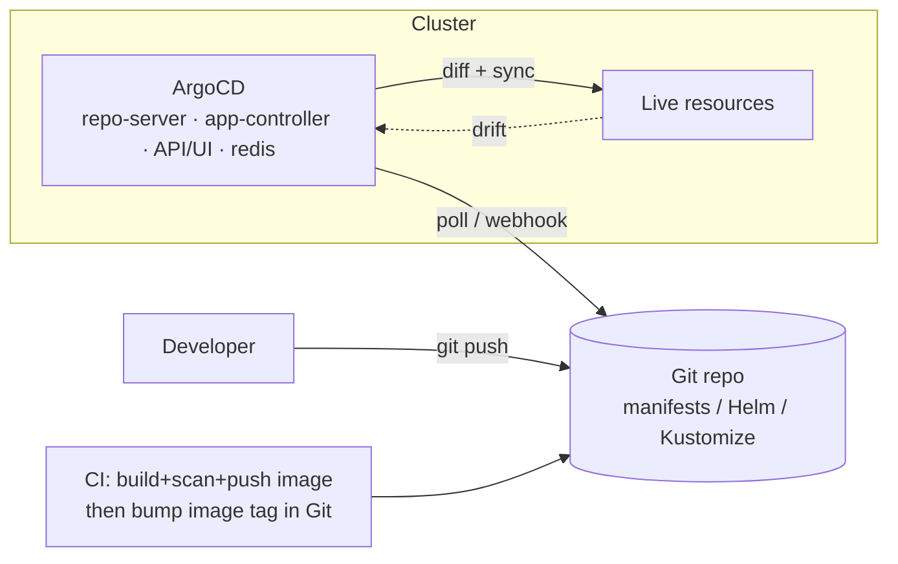

# ArgoCD — GitOps continuous delivery

**GitOps**: Git is the single source of truth. ArgoCD runs *in* the cluster, continuously compares the Git repo (desired) with the cluster (live) and syncs differences.


**Push (CI/CD) vs Pull (GitOps)**: no cluster credentials in CI, automatic drift correction (`selfHeal`), audit trail = Git history, rollback = `git revert`.

## Core concepts
| Concept | Meaning |
|---|---|
| **Application** | CRD: source (repo/path/chart) → destination (cluster/namespace) |
| **AppProject** | grouping + RBAC: allowed repos, clusters, namespaces, kinds |
| **Sync status** | `Synced` / `OutOfSync` |
| **Health status** | `Healthy` / `Progressing` / `Degraded` / `Missing` |
| **syncPolicy.automated** | auto-sync; `prune` deletes removed resources; `selfHeal` reverts manual changes |
| **Sync waves / hooks** | order resources (`argocd.argoproj.io/sync-wave: "1"`), PreSync/PostSync Jobs |
| **App of Apps / ApplicationSet** | one root app creates many apps (per env / per cluster / per directory) |
| **Rollouts** (Argo Rollouts) | canary / blue-green progressive delivery |

## Install
```bash
kubectl create namespace argocd
kubectl apply -n argocd -f https://raw.githubusercontent.com/argoproj/argo-cd/stable/manifests/install.yaml
kubectl wait --for=condition=available deploy/argocd-server -n argocd --timeout=300s
# initial admin password
kubectl -n argocd get secret argocd-initial-admin-secret -o jsonpath="{.data.password}" | base64 -d; echo
# UI
kubectl port-forward svc/argocd-server -n argocd 8080:443      # https://localhost:8080  (user: admin)
# CLI
argocd login localhost:8080 --username admin --insecure
```
(Helm alternative: `helm repo add argo https://argoproj.github.io/argo-helm && helm install argocd argo/argo-cd -n argocd --create-namespace`)

## Deploy your first app
```bash
kubectl apply -f manifests/application-basic.yaml
argocd app list
argocd app get guestbook
argocd app sync guestbook
argocd app history guestbook
argocd app rollback guestbook <ID>
```
Now **edit the live Deployment** (`kubectl scale ... --replicas=5`) → with `selfHeal` ArgoCD reverts it. Edit Git → ArgoCD applies it. 

## Manifests
- [`application-basic.yaml`](manifests/application-basic.yaml) — plain directory app
- [`application-helm.yaml`](manifests/application-helm.yaml) — Helm source with values
- [`appproject.yaml`](manifests/appproject.yaml) — project with guard rails
- [`app-of-apps.yaml`](manifests/app-of-apps.yaml) — root app
- [`applicationset.yaml`](manifests/applicationset.yaml) — generate an app per environment
- [`private-repo-secret.yaml`](manifests/private-repo-secret.yaml) — private Git credentials (template)

## Typical GitOps repo layout
```
gitops-repo/
├── apps/                 # Application manifests (App-of-Apps root points here)
│   ├── web-dev.yaml
│   └── web-prod.yaml
└── charts-or-kustomize/web/...
```
## Best practices
- Separate **app code repo** and **config (GitOps) repo**; CI updates image tag in config repo.
- Never put plain Secrets in Git → Sealed Secrets / SOPS / External Secrets.
- Use `AppProject` per team; enable SSO + RBAC; disable the `admin` user afterwards.
- Pin chart/image versions; use sync windows for prod.

## ✅ Labs
1. Install ArgoCD; deploy the guestbook app; break it manually; watch self-heal.
2. Fork this repo; point an Application at `projects/project-3-argocd-gitops/gitops/apps/web`.
3. Create an ApplicationSet for dev/prod; promote by changing a value in Git.
4. Roll back via `argocd app rollback` and via `git revert` — compare.

## 📝 Quiz
1. What does `prune: true` do? *(deletes cluster resources no longer in Git)*
2. How does ArgoCD detect drift? *(compares rendered Git manifests with live state)*
3. Why pull-based? *(no cluster creds in CI, self-heal, auditability)*
