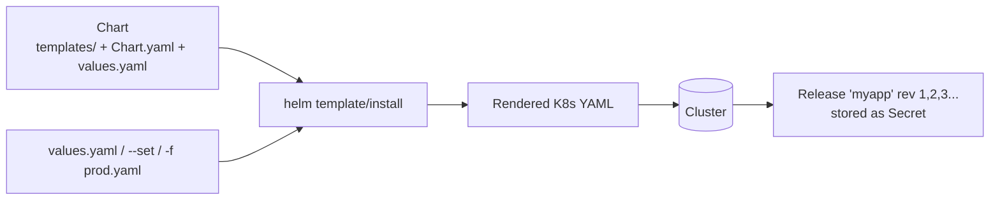

# Helm — the Kubernetes package manager

Helm packages many manifests into a **chart**, templates them with **values**, and tracks installs as **releases** (with history & rollback).


| Term | Meaning |
|---|---|
| Chart | package (folder or `.tgz`) |
| Release | one installed instance of a chart |
| Repository | HTTP/OCI place hosting charts |
| Values | config that fills templates |
| Revision | each upgrade increments it → rollback |

## Everyday commands
```bash
helm repo add bitnami https://charts.bitnami.com/bitnami && helm repo update
helm search repo nginx
helm show values bitnami/nginx > values-nginx.yaml
helm install web bitnami/nginx -n demo --create-namespace -f values-nginx.yaml --set replicaCount=2
helm list -A
helm upgrade web bitnami/nginx -n demo --set replicaCount=3 [--install] [--atomic --timeout 5m]
helm history web -n demo
helm rollback web 1 -n demo
helm uninstall web -n demo
helm template web ./mychart -f values-prod.yaml      # render locally, no cluster
helm lint ./mychart
helm install web ./mychart --dry-run --debug
helm package ./mychart && helm push mychart-0.1.0.tgz oci://<acct>.dkr.ecr.<region>.amazonaws.com/
helm get values|manifest|notes web -n demo
```

## Build your own chart
A complete working chart is in [`kubelab-chart/`](kubelab-chart):
```
kubelab-chart/
├── Chart.yaml            # metadata + dependencies
├── values.yaml           # defaults (documented)
├── values-dev.yaml  values-prod.yaml
├── .helmignore
└── templates/
    ├── _helpers.tpl      # reusable named templates
    ├── deployment.yaml  service.yaml  ingress.yaml  hpa.yaml
    ├── configmap.yaml   serviceaccount.yaml  pdb.yaml
    ├── NOTES.txt         # printed after install
    └── tests/test-connection.yaml   # helm test
```
Try it:
```bash
helm lint tools/03-helm/kubelab-chart
helm template demo tools/03-helm/kubelab-chart -f tools/03-helm/kubelab-chart/values-dev.yaml
helm install demo tools/03-helm/kubelab-chart -n demo --create-namespace -f tools/03-helm/kubelab-chart/values-dev.yaml
helm test demo -n demo
```

## Template language cheat-sheet (Go templates + Sprig)
```yaml
{{ .Values.replicaCount }}                    # values
{{ .Release.Name }} {{ .Release.Namespace }}  # release info
{{ .Chart.Name }} {{ .Chart.AppVersion }}     # chart info
{{ include "kubelab.fullname" . }}            # call named template
{{- if .Values.ingress.enabled }} ... {{- end }}
{{- range $k, $v := .Values.env }} - name: {{ $k }}  value: {{ $v | quote }} {{- end }}
{{ .Values.image.tag | default .Chart.AppVersion }}
{{ toYaml .Values.resources | nindent 12 }}
{{ with .Values.nodeSelector }} nodeSelector: {{ toYaml . | nindent 8 }} {{ end }}
{{ required "image.repository is required" .Values.image.repository }}
checksum/config: {{ include (print $.Template.BasePath "/configmap.yaml") . | sha256sum }}   # roll pods on config change
```
Also: **hooks** (`helm.sh/hook: pre-install,pre-upgrade`), **subcharts/dependencies** (`helm dependency update`), **library charts**, **values.schema.json** (validate input), **OCI registries**, **helm diff** plugin, **Helmfile**.

## Helm vs Kustomize
Helm = templating + packaging + release lifecycle. Kustomize = overlays of plain YAML. Use Helm for distributing apps, Kustomize for env patches — or Helm + ArgoCD together.

## ✅ Labs
1. Install `bitnami/nginx`, upgrade values, rollback.
2. `helm create` a chart; compare to `kubelab-chart`.
3. Add a `values.schema.json` rule making `replicaCount` an integer ≥ 1.
4. Package the chart and push it to an OCI registry (ECR / ghcr).

## 📝 Quiz
1. Where does Helm store release state? *(Secrets in the release namespace)*
2. `helm template` vs `helm install --dry-run`? *(template = fully offline; dry-run contacts the API server)*
3. How do you force pods to roll when a ConfigMap changes? *(checksum annotation)*
