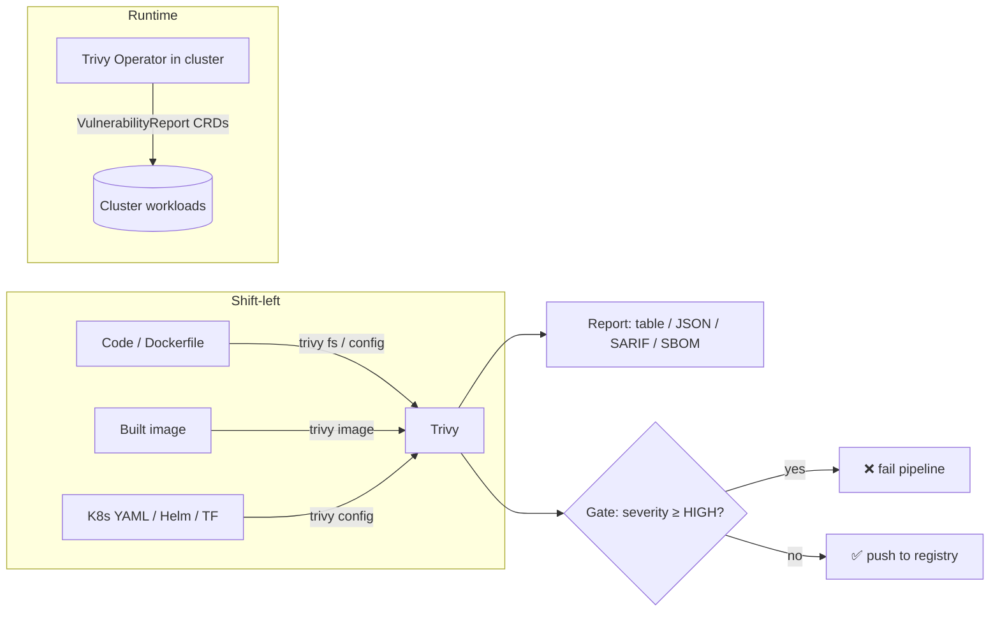

# Trivy — security scanner for images, IaC, filesystems and clusters

Trivy (by Aqua Security) finds: **OS/library vulnerabilities (CVEs)**, **misconfigurations** (Dockerfile, K8s YAML, Terraform, Helm), **secrets**, **licenses**, and generates **SBOMs**.



## Install
```bash
# macOS
brew install trivy
# Debian/Ubuntu
sudo apt-get install -y wget gnupg
wget -qO - https://aquasecurity.github.io/trivy-repo/deb/public.key | gpg --dearmor | sudo tee /usr/share/keyrings/trivy.gpg >/dev/null
echo "deb [signed-by=/usr/share/keyrings/trivy.gpg] https://aquasecurity.github.io/trivy-repo/deb generic main" | sudo tee /etc/apt/sources.list.d/trivy.list
sudo apt-get update && sudo apt-get install -y trivy
# Docker (no install)
docker run --rm -v /var/run/docker.sock:/var/run/docker.sock aquasec/trivy:latest image nginx:1.27
```

## Scan targets
```bash
# 1. Container image
trivy image nginx:1.27
trivy image --severity HIGH,CRITICAL --ignore-unfixed nginx:1.27
trivy image --exit-code 1 --severity CRITICAL myapp:1.0            # fail CI
trivy image -f json -o report.json myapp:1.0
trivy image --format sarif -o trivy.sarif myapp:1.0                # GitHub code scanning

# 2. Filesystem / repo (deps + secrets + misconfig)
trivy fs --scanners vuln,secret,misconfig .

# 3. IaC & Kubernetes manifests (misconfigurations)
trivy config ./01-fundamentals/manifests
trivy config ./tools/03-helm/kubelab-chart
trivy config ./10-cluster-setup/eks-terraform

# 4. Live cluster
trivy k8s --report summary cluster
trivy k8s --report all --namespace lab deployment/web

# 5. SBOM
trivy image --format cyclonedx -o sbom.cdx.json myapp:1.0
trivy sbom sbom.cdx.json

# 6. Remote git repo
trivy repo https://github.com/<you>/<repo>
```
**Severity**: UNKNOWN · LOW · MEDIUM · HIGH · CRITICAL. Use `.trivyignore` for accepted CVEs (with justification & expiry!). 
Misconfig example IDs: `KSV001` (privilege escalation allowed), `KSV012` (runs as root), `KSV014` (writable rootfs), `DS002` (Dockerfile runs as root).

## Fixing findings — the real workflow
1. Use minimal/updated base images (`python:3.12-slim`, distroless, `alpine`).
2. Multi-stage builds (no build tools in final image).
3. Upgrade the vulnerable package or base image tag; rebuild; rescan.
4. For K8s misconfig: apply SecurityContext hardening (see `07-security`).
5. Re-scan in CI on every PR **and** nightly (new CVEs appear daily).

Try it: scan [`manifests/vulnerable-pod.yaml`](manifests/vulnerable-pod.yaml) with `trivy config`, then compare with the hardened one in `07-security/manifests/02-secure-pod.yaml`.

## Trivy Operator (continuous in-cluster scanning)
```bash
helm repo add aqua https://aquasecurity.github.io/helm-charts/ && helm repo update
helm install trivy-operator aqua/trivy-operator -n trivy-system --create-namespace --version 0.24.1 \
  --set trivy.ignoreUnfixed=true
kubectl get vulnerabilityreports -A -o wide
kubectl get configauditreports -A
kubectl get exposedsecretreports -A
kubectl get rbacassessmentreports -A
```
(Check the latest chart version with `helm search repo aqua/trivy-operator`.)

## GitHub Actions (also used in Project 6)
[`github-actions-trivy.yml`](github-actions-trivy.yml) — builds an image, scans it, uploads SARIF, fails on CRITICAL.

## ✅ Labs
1. Scan `nginx:1.21` vs `nginx:1.27` and compare CVE counts.
2. Scan the sample app image; harden Dockerfile; rescan.
3. `trivy config` on all manifests in this repo; fix 3 findings.
4. Install Trivy Operator and list `vulnerabilityreports`.
5. Generate an SBOM and scan the SBOM.

## 📝 Quiz
1. `trivy fs` vs `trivy image`? *(local files/deps vs built container image)*
2. Why `--ignore-unfixed`? *(hide CVEs with no available patch to reduce noise)*
3. What does the Trivy Operator produce? *(CRD reports per workload)*
