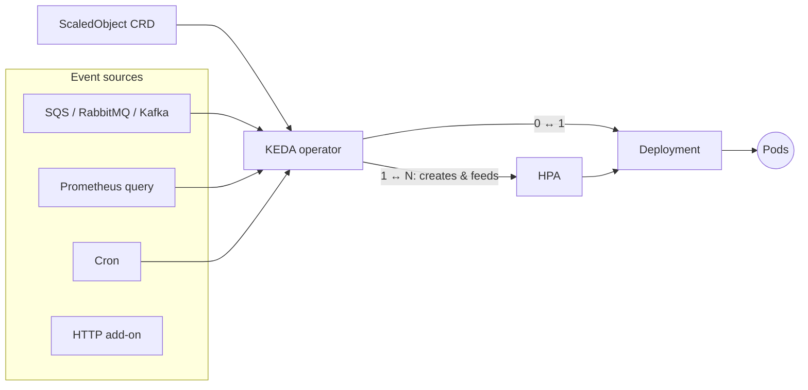

# KEDA — Kubernetes Event-Driven Autoscaling

HPA scales on CPU/memory. **KEDA scales on events**: queue length, Kafka lag, HTTP rate, Prometheus query, cron schedules, DB rows… and can **scale to zero**.


**How it works:** KEDA = operator + metrics adapter. When there is no work it keeps replicas at `minReplicaCount` (can be **0**); when the first event arrives it activates (0→1) and then lets an HPA scale 1→N using external metrics.

## Components
| Piece | Role |
|---|---|
| `keda-operator` | watches ScaledObjects, handles 0↔1 activation |
| `keda-operator-metrics-apiserver` | serves external metrics to HPA |
| `keda-admission-webhooks` | validates resources |
| **ScaledObject** | scale a Deployment/StatefulSet/any scalable resource |
| **ScaledJob** | spawn one Job per work item (long-running tasks) |
| **TriggerAuthentication** | credentials for scalers (secrets, IRSA, Vault…) |

## Install
```bash
helm repo add kedacore https://kedacore.github.io/charts && helm repo update
helm install keda kedacore/keda -n keda --create-namespace
kubectl get pods -n keda
kubectl get crd | grep keda
```
(On EKS with SQS: give the `keda-operator` ServiceAccount an IRSA role and use `podIdentity: {provider: aws}` in TriggerAuthentication.)

## Examples (all in `manifests/`)
| File | Scaler | Demonstrates |
|---|---|---|
| [`01-cron-scaledobject.yaml`](manifests/01-cron-scaledobject.yaml) | cron | business-hours scaling, **no extra infra needed** |
| [`02-cpu-memory-scaledobject.yaml`](manifests/02-cpu-memory-scaledobject.yaml) | cpu/memory | HPA-like, with KEDA |
| [`03-redis-list-scaledobject.yaml`](manifests/03-redis-list-scaledobject.yaml) | redis list | queue worker, **scale to zero** (full demo) |
| [`04-prometheus-scaledobject.yaml`](manifests/04-prometheus-scaledobject.yaml) | prometheus | scale on a PromQL query |
| [`05-sqs-scaledobject.yaml`](manifests/05-sqs-scaledobject.yaml) | aws-sqs-queue | IRSA + TriggerAuthentication |
| [`06-scaledjob.yaml`](manifests/06-scaledjob.yaml) | redis list | one Job per message |

### Hands-on demo: scale-to-zero worker (Redis)
```bash
kubectl create ns keda-demo
kubectl apply -f manifests/03-redis-list-scaledobject.yaml
kubectl get pods -n keda-demo -w                       # worker: 0 replicas
# push 50 jobs onto the queue
kubectl exec -n keda-demo deploy/redis -- sh -c 'for i in $(seq 1 50); do redis-cli RPUSH jobs "task-$i"; done'
# watch worker pods go 0 → N, then back to 0 after queue drains + cooldownPeriod
kubectl get scaledobject,hpa -n keda-demo
```
```
queue length   0 ───► 50 ───► 0
worker pods    0 ───► 5  ───► 0     (listLength: 10 per pod)
```

## Key ScaledObject fields
`scaleTargetRef`, `minReplicaCount` (0 allowed), `maxReplicaCount`, `pollingInterval` (default 30s), `cooldownPeriod` (300s, applies for →0), `idleReplicaCount`, `fallback`, `advanced.horizontalPodAutoscalerConfig.behavior`, `triggers[]` (multiple → max wins).

## KEDA vs HPA vs Karpenter
| | HPA | KEDA | Karpenter |
|---|---|---|---|
| Scales | pods | pods (incl. 0) | **nodes** |
| Signal | CPU/mem/custom | 60+ event sources | Pending pods |
| Together | | KEDA adds pods → pods Pending → Karpenter adds nodes → pods run | |

## ✅ Labs
1. Cron scaler: scale `web` to 3 during a 5-min window.
2. Run the Redis demo and observe scale to zero.
3. Add a second trigger (cpu) and see "max wins" behaviour.
4. (AWS) SQS scaler with IRSA.

## 📝 Quiz
1. Can HPA scale to zero? *(No — KEDA can.)*
2. Does KEDA replace HPA? *(It creates and manages an HPA for 1→N.)*
3. ScaledObject vs ScaledJob? *(scale replicas of a workload vs run a Job per event)*
