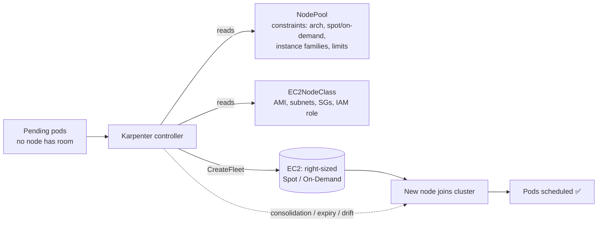

# Karpenter — just-in-time node provisioning (AWS EKS)

Karpenter watches for **unschedulable (Pending) Pods**, picks the cheapest/best-fitting EC2 instance(s) for them, launches nodes in ~1 minute, and **removes/consolidates** nodes when they're empty or under-used.


## Karpenter vs Cluster Autoscaler
| | Cluster Autoscaler | Karpenter |
|---|---|---|
| Works with | pre-defined node groups (ASGs) | direct EC2 API, no node groups |
| Instance choice | fixed per group | any type that fits pending pods (bin-packing) |
| Speed | minutes | ~45–90 s |
| Cost features | limited | Spot, consolidation, TTL/expiry, drift |

## Concepts (API `karpenter.sh/v1`)
| CRD | Purpose |
|---|---|
| **NodePool** | *What* may be launched: requirements (instance category/size/arch/capacity-type/zone), taints, labels, `limits` (max CPU/mem), `disruption` policy, `expireAfter` |
| **EC2NodeClass** | *How* on AWS: AMI family/alias, subnet & SG selectors (tags), IAM role, block devices, userData |
| **NodeClaim** | the actual request for a node (created by Karpenter; useful for debugging) |

**Disruption**: `consolidationPolicy: WhenEmptyOrUnderutilized` (replace/merge nodes to save money), `consolidateAfter`, `budgets` (e.g. max 10% nodes at once, none during business hours), **drift** (AMI/NodePool changed → roll nodes), `expireAfter` (e.g. 720h force-refresh). Protect workloads with **PDBs** and annotation `karpenter.sh/do-not-disrupt: "true"`.

## Prerequisites
- EKS cluster with OIDC & **tagged subnets/security groups** `karpenter.sh/discovery=<cluster-name>` (the Terraform in `10-cluster-setup/eks-terraform` already does this).
- A small **managed node group** (2 nodes) to run Karpenter itself (don't let Karpenter schedule itself).
- IAM: controller role (IRSA/Pod Identity) + **node role** + SQS interruption queue (for Spot interruption handling).

## Install (summary — follow the official guide for the exact current version)
Official guide: https://karpenter.sh/docs/getting-started/getting-started-with-karpenter/
```bash
export CLUSTER_NAME=k8s-lab
export AWS_REGION=ap-south-1
export KARPENTER_NAMESPACE=kube-system
export KARPENTER_VERSION=<latest-1.x>     # see https://github.com/aws/karpenter-provider-aws/releases

# 1. IAM + SQS + EventBridge via CloudFormation (template in the official guide, from the same version)
curl -fsSL https://raw.githubusercontent.com/aws/karpenter-provider-aws/v${KARPENTER_VERSION}/website/content/en/preview/getting-started/getting-started-with-karpenter/cloudformation.yaml > cf.yaml
aws cloudformation deploy --stack-name "Karpenter-${CLUSTER_NAME}" --template-file cf.yaml \
  --capabilities CAPABILITY_NAMED_IAM --parameter-overrides "ClusterName=${CLUSTER_NAME}"

# 2. Map node role + create controller IRSA (eksctl)
eksctl create iamidentitymapping --cluster ${CLUSTER_NAME} --region ${AWS_REGION} \
  --arn "arn:aws:iam::$(aws sts get-caller-identity --query Account --output text):role/KarpenterNodeRole-${CLUSTER_NAME}" \
  --username 'system:node:{{EC2PrivateDNSName}}' --group system:bootstrappers --group system:nodes

# 3. Helm install (OCI chart)
helm upgrade --install karpenter oci://public.ecr.aws/karpenter/karpenter --version "${KARPENTER_VERSION}" \
  --namespace "${KARPENTER_NAMESPACE}" --create-namespace \
  --set "settings.clusterName=${CLUSTER_NAME}" \
  --set "settings.interruptionQueue=${CLUSTER_NAME}" \
  --set controller.resources.requests.cpu=1 --set controller.resources.requests.memory=1Gi \
  --wait

# 4. Create NodePool + EC2NodeClass
envsubst < manifests/ec2nodeclass.yaml | kubectl apply -f -
kubectl apply -f manifests/nodepool-default.yaml
kubectl get nodepools,ec2nodeclasses
```
(`envsubst` fills `${CLUSTER_NAME}`; set `KARPENTER_NODE_ROLE=KarpenterNodeRole-${CLUSTER_NAME}` too.)

## Demo: watch nodes appear and disappear
```bash
kubectl apply -f manifests/inflate.yaml                 # 0 replicas
kubectl scale deploy inflate --replicas=10               # each pod requests 1 CPU
kubectl logs -f -n kube-system -l app.kubernetes.io/name=karpenter | grep -i -E "launched|created"
kubectl get nodeclaims,nodes -L karpenter.sh/capacity-type,node.kubernetes.io/instance-type -w
kubectl scale deploy inflate --replicas=0                # empty nodes removed (consolidation)
```
```
Time →     t0          t+10s            t+60s              t+5min
Pods       10 Pending   10 Pending       10 Running         0
Nodes      2            2 (+NodeClaim)   2 + 1 c5.4xlarge   2   (consolidated away)
```

## Manifests
- [`ec2nodeclass.yaml`](manifests/ec2nodeclass.yaml) · [`nodepool-default.yaml`](manifests/nodepool-default.yaml) (spot+on-demand, consolidation, limits)
- [`nodepool-gpu-or-dedicated.yaml`](manifests/nodepool-gpu-or-dedicated.yaml) (tainted dedicated pool)
- [`inflate.yaml`](manifests/inflate.yaml) (load generator)

## Best practices
1. Set `limits` on NodePools (cost guardrail!).
2. Diversify instance types (broad requirements → more Spot capacity).
3. Always set Pod **requests** (Karpenter bin-packs on requests).
4. Use PDBs + `topologySpreadConstraints` for HA during consolidation.
5. Run Karpenter on a Fargate / managed node group, not on nodes it manages.
6. Handle Spot interruptions via the SQS queue (included in guide).
7. Pin AMIs (`amiSelectorTerms` alias like `al2023@v20xxxxxx`) in prod; use `@latest` only in dev.

## Troubleshooting
| Symptom | Check |
|---|---|
| Pods Pending, no NodeClaim | `kubectl logs` karpenter; NodePool requirements too tight; pod requests > any instance |
| NodeClaim stuck | IAM node role missing / not mapped; subnet/SG tag selectors match nothing; EC2 quota |
| Nodes never removed | PDBs, `do-not-disrupt`, `consolidationPolicy`, pods without controllers |
| Spot unavailable | add more instance families / fall back to on-demand |

## Cleanup
```bash
kubectl delete deploy inflate
kubectl delete nodepools --all && kubectl delete ec2nodeclasses --all     # wait for nodes to go
helm uninstall karpenter -n kube-system
aws cloudformation delete-stack --stack-name "Karpenter-${CLUSTER_NAME}"
```

## ✅ Labs
1. Install Karpenter, run `inflate`, observe instance chosen.
2. Restrict NodePool to Spot + arm64 (Graviton) and test (needs multi-arch images).
3. Create a dedicated NodePool (taint) and schedule a Deployment on it with toleration + nodeSelector.
4. Set disruption budget `nodes: "0"` for weekdays and confirm consolidation pauses.
5. Combine with KEDA (Project 5).

## 📝 Quiz
1. What triggers Karpenter to launch nodes? *(unschedulable Pods)*
2. NodePool vs EC2NodeClass? *(scheduling constraints vs AWS-specific config)*
3. Why must Pods set resource requests? *(bin-packing & sizing decisions rely on them)*
