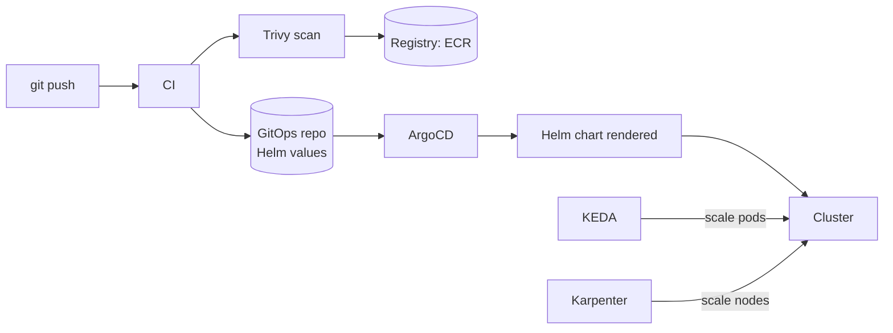

# 🧰 Ecosystem Tools

Do these **after** the core modules (00–10).

| # | Tool | One-liner | Needs |
|---|---|---|---|
| 1 | [Minikube](01-minikube) | local cluster | Docker |
| 2 | [ArgoCD](02-argocd) | GitOps CD | any cluster + a Git repo |
| 3 | [Helm](03-helm) | package manager (+ full sample chart) | any cluster |
| 4 | [Trivy](04-trivy) | vulnerability/misconfig scanning | Docker / CLI |
| 5 | [KEDA](05-keda) | event-driven **pod** autoscaling | any cluster |
| 6 | [Karpenter](06-karpenter) | just-in-time **node** autoscaling | AWS EKS |

All six work together in [Project 6](../projects/project-6-devsecops-pipeline-full-stack).
